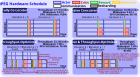
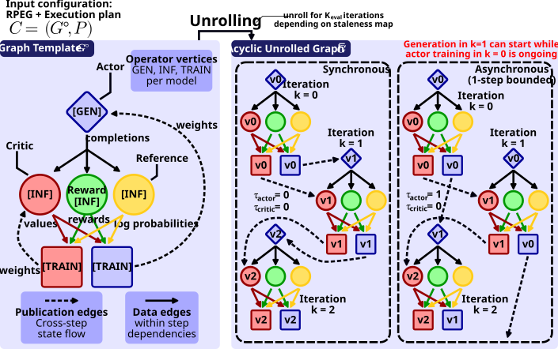
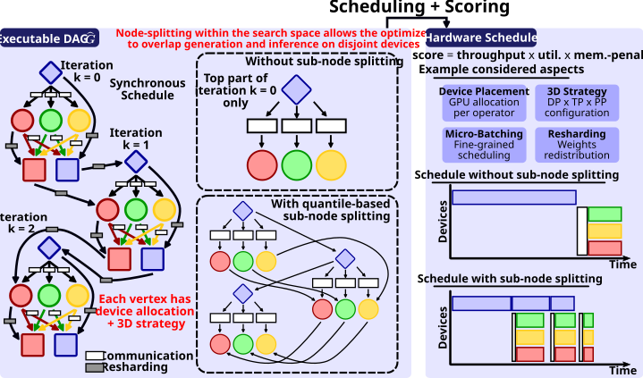

# RLM Pipeline Execution Graph (RPEG)

<div align="center">

**[Setup Guide](#setup-guide)** |
**[Usage](#usage)** |
**[Workflow](#workflow-overview-and-documentation)** |
**[Citations](#citations)**
</div>

<p align="center">
  
</p>

This is the official implementation of [RPEG: Training Reasoning Language Models Scalably and Cost-Effectively](https://arxiv.org/abs/2611.).

RPEG is a compiler-style optimizer and distributed runtime for RLHF and reasoning language training pipelines.
It jointly searches over **parallelism strategies** (data, pipeline, tensor), **device placement**, **microbatching**, **parameter sharing** (actor-critic weight sharing), **stage fusion** (generation-inference overlap via response-length quantile splitting), and **bounded asynchrony** (staleness-controlled weight updates) to maximize throughput and hardware utilization on multi-GPU clusters.
It supports PPO (with and without actor and critic sharing weights), DPO, as well as GRPO.


## Setup Guide

In order to use this framework, you need to have a working installation of Python 3.10 or newer.

Before running the installation, make sure to activate your Python environment (if any) beforehand.
```bash
git clone https://github.com/spcl/RPEG
cd RPEG
pip install .
```
If you just want to use the analytical model, you can just install `pip install pyyaml matplotlib numpy scipy torch`.
PyTorch with CUDA support is only necessary for the hardware calibration and can be omitted if you want to run RPEG's analytical model on a different machine than the targeted cluster.
In addition to the Python packages, some of the visualizations (`--plots`) require Graphviz, which should be installed through your package manager, for example with `apt install graphviz`.
The runtime additionally requires `ucx_direct` as an importable `ucxx` or legacy `ucp` binding, which should must match the selected architecture of virtual environment or container.
The following instructions assume the use of a SLURM batch systems, but RPEG should work with any batch system.


## Usage

### Step 1: Workload Configuration

The workload configuration specifies the cluster topology, model architectures, RLHF workload, and optimizer settings.

```yaml
# configs/my_workload.yaml

# ── Cluster topology ────────────────────────────────────
hardware:
  racks: 1                   # number of racks
  nodes_per_rack: 8          # nodes per rack
  gpus_per_node: 4           # GPUs per node (total: 1 x 8 x 4 = 32 GPUs)

# ── Transformer architectures ───────────────────────────
models:
  actor:                     # policy model (also used for reference)
    layers: 32
    hidden_dim: 4096
    ffn_dim: 11008
    vocab_size: 32000
    head_dim: 128
  critic:                    # value model
    layers: 32
    hidden_dim: 4096
    ffn_dim: 11008
    vocab_size: 32000
    head_dim: 128
  reward:                    # reward model
    layers: 32
    hidden_dim: 4096
    ffn_dim: 11008
    vocab_size: 32000
    head_dim: 128

# ── RLHF workload ───────────────────────────────────────
workload:
  batch_size: 64             # prompts per iteration
  samples_per_prompt: 1      # rollouts per prompt
  context_length: 128        # prompt length (tokens)
  generation_length: 512     # max generation length (tokens)
  gen_quantiles:             # response-length distribution for stage fusion
    - [0.50, 128]            #   50% of sequences finish by token 128
    - [0.85, 256]            #   85% finish by token 256
    - [1.00, 512]            #   all finish by token 512

# ── Policy ──────────────────────────────────────────────
policy:
  algorithm: ppo             # ppo, grpo, and dpo supported
  allow_ac_share: false      # allow actor-critic weight sharing exploration

# ── Optimizer settings ──────────────────────────────────
optimizer:
  k_eval: 5                  # unrolling depth (iterations to simulate)
  t_init: 0.05               # SA initial temperature
  t_min: 0.05                # SA temperature floor
  t_warm: 0.10               # SA warm-restart temperature
  k_x: 6                     # candidates per focused vertex
  stag_window: 10            # consecutive rejections before restart
  staleness_candidates:      # per-model staleness budgets to explore
    actor: [0, 1]            #   actor: synchronous and 1-step async
    critic: [0]              #   critic: synchronous only

# ── Output ──────────────────────────────────────────────
output:
  plots: true
  plots_dir: figures/runs/my_experiment/
  log_file: logs/my_experiment.log
  base_plan: plans/baseline.yaml    # save baseline plan as YAML
  opt_plan: plans/optimized.yaml    # save optimized plan as YAML
  seed: 42
```


### Step 2: Hardware Calibration

The calibration script runs micro-benchmarks on the target cluster to measure GPU compute throughput, HBM bandwidth, and network latency/bandwidth at all three tiers (intra-node, intra-rack, inter-rack).
The script requires PyTorch with CUDA and has to be done once per target cluster.
The measurements run for roughly 3 minutes.

```bash
srun --ntasks=8 --ntasks-per-node=4 --gres=gpu:4 \
    python calibrate.py --output hw_my_cluster.yaml
```

This produces a hardware configuation with all parameters needed by the analytical cost model:

```yaml
# hw_my_cluster.yaml (auto-generated by calibrate.py)

# ── Compute ──────────────────────────────────────────────
flops_per_gpu:    4.400e+11       # F_peak: 440 TFLOP/s (BF16)
memory_per_gpu:   1.030e+11       # M_GPU:  103 GB HBM3
memory_bandwidth: 1.000e+12       # BW_mem: 1.0 TB/s

# ── Communication (alpha-beta model) ────────────────────
#                  alpha (latency)   beta (1/bandwidth)
#                  ──────────────    ──────────────────
# Collectives (AllReduce, ReduceScatter, AllGather):
alpha_coll_g:     7.800e-05       #  78 us  intra-node
beta_coll_g:      4.545e-09       # 220 GB/s
alpha_coll_n:     2.200e-04       # 220 us  cross-node
beta_coll_n:      8.000e-08       #  12.5 GB/s
alpha_coll_r:     4.400e-04       # inter-rack (estimated 2x cross-node)
beta_coll_r:      1.600e-07

# Point-to-point (pipeline send/recv):
alpha_p2p_g:      3.500e-05       #  35 us  intra-node
beta_p2p_g:       4.545e-09       # 220 GB/s
alpha_p2p_n:      1.800e-04       # 180 us  cross-node
beta_p2p_n:       8.000e-08       #  12.5 GB/s
alpha_p2p_r:      3.600e-04       # inter-rack (estimated 2x cross-node)
beta_p2p_r:       1.600e-07

# ── GEMM SM-utilization ─────────────────────────────────
gemm_m_half:      240.0           # gamma_M: half-saturation batch dim
decode_bw_eff:    0.630           # decode HBM efficiency factor

# ── Non-GEMM overhead per layer ─────────────────────────
non_gemm_constant: 1.200e-04      # c_ng (TP-independent): 0.12 ms/layer
non_gemm_scaling:  3.500e-04      # c_ng (TP-dependent):   0.35 ms/layer
non_gemm_batch_cal: 64            # reference batch size for calibration
```


### Step 3: Run the Optimizer

```bash
python pipeline.py \
    --hw hw_my_cluster.yaml \
    --config configs/my_workload.yaml \
    --time 600                          # 10-minute search budget (seconds)
```

The `--hw` flag merges calibrated hardware parameters into the configuration.
The `--time` flag sets a wall-clock budget for the SA search loop (auto-derives evaluation budget).
Optional: `--plots` (graph + Gantt PDFs), `--debug` (verbose output).

The optimizer outputs a per-vertex plan comparison and metrics table:

```
══════════════════════════════════════════════════════════════════════════════════════════
  Results
══════════════════════════════════════════════════════════════════════════════════════════

  Search statistics
    wall time   312.4s
    cache       hits=142857  misses=25000  (85.1%)

  Structure
    ac_share    False
    tau         {Pi:1, V:0}

  Per-vertex plan (base → optimal):
      vertex  parallelism (dp,pp,tp)     mb  placement (rack, nodes, gpus)
      ──────  ──────────────────────  ─────  ──────────────────────────────────────────
   *  g_pi    (4,1,1) -> (2,1,1)        16  r0 n[0-3] g[0-3]  ->  r0 n[0-1] g[0-3]
   *  i_R     (4,1,1) -> (1,2,1)         8  r0 n[0-3] g[0-3]  ->  r0 n[2-3] g[0-3]
   *  i_V     (4,1,1) -> (2,1,2)         4  r0 n[0-3] g[0-3]  ->  r0 n[4-5] g[0-3]
   *  i_ref   (4,1,1) -> (1,2,1)         8  r0 n[0-3] g[0-3]  ->  r0 n[2-3] g[0-3]
   *  t_V     (4,1,1) -> (2,2,2)        16  r0 n[0-3] g[0-3]  ->  r0 n[4-7] g[0-3]
   *  t_pi    (4,1,1) -> (2,2,2)        16  r0 n[0-3] g[0-3]  ->  r0 n[0-3] g[0-3]

  Metric                        Greedy  Conc. Heuristic         Optimized  Δ (vs greedy)
  ────────────────────────────  ────────────────────────  ────────────────  ──────────────
  Throughput (tokens/s)         1.2340e+04      1.8921e+04      2.4563e+04         +99.1%
  Makespan (s)                  3.3210e+00      2.1654e+00      1.6688e+00
  Throughput (PFLOP/s)              0.1823          0.2795          0.3628         +99.1%
  GPU utilization                    100.0%           62.3%           78.1%
  Active GPUs                           32              32              32
```


### Step 4 Run the Proposed Plan via the Runtime

The plan, proposed by the optimizer, has to be translated into a job, that can be executed by the runtime, which can be done via `runtime.job_plan`.
The job input must include model locations and runtime settings, as explained in the [runtime guide](RPEG/runtime/README.md#planning-a-runtime-job).
`--emit-sbatch` writes a Slurm submission script, but does not submit a job itself.

```bash
python -m runtime.job_plan \
    --config /path/to/optimizer_runtime.yaml \
    --out-dir /tmp/rpeg-job \
    --emit-sbatch
```

You can directly run the just generated job by executing:
```bash
python -m runtime.run --config /tmp/rpeg-job/run.yaml
```


## Workflow Overview and Documentation

The paper gives a high-level overview of the framework and its components.
In order to understand the framework in more detail, you can read the documentation of the individual modules.

Our framework starts with a configuration consisting of an [RLM Pipeline Execution Graph (RPEG)](RPEG/ir#rlm-pipeline-execution-graphs), which reflects one of the targeted policy optimization algorithms (PPO, DPO, and GRPO), and an execution plan.
The steady-state graph template $G^\circ$ is [unrolled](RPEG/passes#unrolling) for a user-specified number of iterations according to the staleness map into an acyclic unrolled graph $\bar G$.

<p align="center">
  
</p>

$\bar G$ is subsequently [lowered](RPEG/passes#lowering) into an executable DAG $\hat G$, which also accounts for communication and potential resharding.
From this DAG a hardware [schedule](RPEG/schedule#scheduling-and-graph-score) is derived and scored according to the optimization objective.
Scoring uses an [analytical cost model](RPEG/model#node-cost) and also considers the [memory feasibility](RPEG/model#memory-cost).

<p align="center">
  
</p>

The [search](RPEG/search#search-and-optimization) loop then iterates over these steps by either improving the graph or the execution plan.

The [runtime compiler](RPEG/runtime/README.md#compilation-and-exact-schedules) then verifies the plan and reconstructs its graph, workers, and resource ownership.
The executor dispatches ready operations, where model handlers perform generation, inference, training, and transfers.
Traces record the events needed to verify execution.
The runtime executes a fixed compiled plan.
Observations can inform a later calibration or search run, since RPEG supports runtime-informed scaling of certain parameters.


## Paper Results

You can run the experiments from the paper by following the instructions in the [experiments](experiments) directory.
However, if you just want to inspect and replot the results, you can use the [paper](paper) directory.


## Citations

If you find this repository useful, please consider giving it a star! If you have any questions or feedback, don't hesitate to reach out and open an issue.

When using this in your work, please reference us with the citation provided below:

```bibtex
@misc{besta2026rpeg,
  title = {{RPEG: Training Reasoning Language Models Scalably and Cost-Effectively}},
  author = {Besta, Maciej and Schmidt, Leonard and Pang, Pierre and Okanovic, Patrik and Gerstenberger, Robert and Hoefler, Torsten},
  year = 2026,
  month = Nov,
  doi = {10.48550/arXiv.2611.},
  url = {http://arxiv.org/abs/2611.},
  eprinttype = {arXiv},
  eprint = {2611.}
}
```
