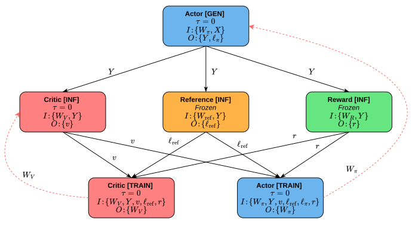
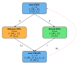
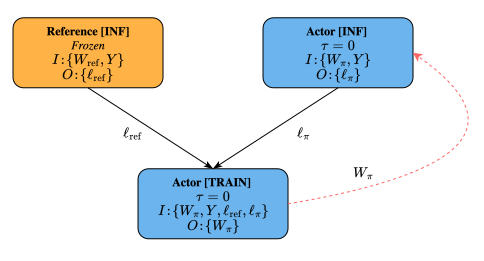

# RLM Pipeline Execution Graphs

An RLM Pipeline Execution Graph (RPEG) is formalized as a tuple:
```math
G^\circ = (V^\circ, E^\circ_{\mathrm{data}}, E^\circ_{\mathrm{pub}}, A, \tau, M_{\mathrm{train}}),
```
where:
- $V^\circ$ is a finite set of RPEG vertices (representing model invocations);
- $E^\circ_{\mathrm{data}}$ and $E^\circ_{\mathrm{pub}}$ are finite sets of data and publication edges, where each edge $e = (u \to v, a)$ connects a source vertex $u$ to a destination vertex $v$ and carries a single container $a \in A$;
- $A$ is the finite set of containers referenced by the RPEG; the boundary subsets $A_{\mathrm{in}}^\circ, A_{\mathrm{out}}^\circ \subseteq A$ (external inputs and outputs) are characterized by a well-formedness condition 3 (see below); 
- $M_{\mathrm{train}}\subset M$ is the set of trainable models, where $M$ denotes the full set of models in the pipeline (e.g., actor, critic, reference, reward for PPO-based training);
- $\tau: M_{\mathrm{train}}\to\mathbb N$ assigns a bounded-staleness budget per trainable model.

The RPEG class can be found in [rpeg.py](rpeg.py) and construction functions for [PPO](ppo.py), [GRPO](grpo.py), [DPO](dpo.py), and [PPO with actor-critic weight sharing](ac_share.py) are provided as well.


### Examples

The following figure illustrates the PPO RPEG.
The trainable model set is $M_\mathrm{train}=\{\pi_\theta, V_\psi\}$ (actor and critic), both with staleness budget $\tau=0$ (synchronous execution).
External inputs are $A^\circ_\mathrm{in}=\{X, W_\mathrm{ref}, W_R\}$, and no external outputs are exposed ($A^\circ_\mathrm{out}=\emptyset$). 
Containers: $X$ = prompts, $Y$ = completions, $v$ = per-token value predictions, $r$ = per-completion reward, $\ell_\mathrm{ref}$ = reference log-probs, $\ell_\pi$ = actor log-probs, and $W_m$ = model $m$'s weights.
Edges encode scheduling dependencies, not all data accesses: boundary inputs $A^\circ_\mathrm{in}$ are accessible to all operators that declare them in their interface, and containers such as $Y$ and $\ell_\pi$ reach training transitively through the assessment stage without requiring direct edges.
The structure is shown for a fixed workload.
<p align="center">
  
</p>


The GRPO RPEG is shown in the figure below.
<p align="center">
  
</p>

Similarly, the subsequent figure illustrates the DPO RPEG.
<p align="center">
  
</p>


## Vertices and Operator Kinds

Each [RPEG vertex](../core/types.py#L313) $v\in V^\circ$ represents a model invocation. A vertex is characterized by three attributes:
- a role $r(v)\in  \{\text{generation, inference, training}\}$,
- a model $\mu(v)\in M$, and
- input/output container interfaces $\mathcal{I}(v), \mathcal{O}(v)\subseteq A$ declaring which containers the operator may read and write.

$\kappa(v) = (r(v), \mu(v), \mathcal{I}(v), \mathcal{O}(v))$ is used for the operator kind of $v$.

The vertex set therefore determines which models participate in the algorithm and how they appear within one iteration.
Different policy optimization algorithms correspond to different choices of $V^\circ$ and dependency structure $(E^\circ_\mathrm{data}, E^\circ_\mathrm{pub})$.
For example, the base PPO RPEG comprises six vertices (generation, three inference passes, and two training passes) while GRPO eliminates the critic and reduces the graph to four vertices.
DPO removes online generation entirely, collapsing the graph to three vertices.


## Containers

A [container](../core/types.py#L267) is a pair $a = (\\#a,\; s(a))$, where $\\#a$ is the element count and $s(a)$ is the element size in Bytes. The total Byte volume of a container is $\\#a \cdot s(a)$.

Containers make communication volume explicit in the IR: the Byte volume $\\#a \cdot s(a)$ of a container on a connecting edge determines the data transfer cost when source and destination are placed on different devices.
The set $A$ collects all containers in the RPEG, covering both within-step data (e.g., completions, log-probabilities, or rewards) and cross-step model weights.


## Data and Publication Edges

Each [RPEG edge](../core/types.py#L327) carries exactly one container and represents the algorithmic dependence of the destination on the data produced by the source. The RPEG distinguishes two classes of edges:
- **Data edges** $E^\circ_{\mathrm{data}}$ represent within-step dependencies. Generation produces completions consumed by inference; inference produces log-probabilities, rewards, and values consumed by training.
- **Publication edges** $E^\circ_{\mathrm{pub}}$ represent cross-step weight updates. After training updates a model's parameters, a publication edge carries the new weights to the operators that consume them in subsequent iterations. These are the edges whose unrolling semantics are governed by the staleness budget $\tau$.

An important distinction separates edges from operator interfaces.
Each operator declares input and output interfaces ($\mathcal{I}$ and $\mathcal{O}$) that specify which containers it may access, but not every declared input requires a corresponding incoming edge, since edges impose both a data-transfer requirement and a scheduling dependency.
Two cases lack edges: boundary inputs $A^\circ_\mathrm{in}$ (e.g., prompts, frozen weights) are accessible to all operators that declare them since they are external to the graph; and containers already resident from a prior stage can be accessed transitively without a direct edge.
For example, training operators read $Y$ and $\ell_\pi$ from generation, but the RPEG omits direct generation-to-training edges – the transitive dependency through assessment ensures correct ordering and avoids an unnecessary scheduling constraint.


## Cyclic Structure and Staleness

The RPEG's cyclic design offers three advantages over working directly on a flat (unrolled) DAG.
1. Compact search space: the execution plan assigns one parallelization strategy per RPEG vertex, so in a PPO-based pipeline six entries determine the strategy for all $6 \cdot K_\mathrm{eval}$ unrolled operators. Operating on the flat DAG would inflate the search space by a factor of $K_\mathrm{eval}^{|V^\circ|}$ or require an explicit constraint that all copies share the same strategy – effectively reintroducing the RPEG abstraction under a different name.
2. Staleness as an explicit search parameter: the optimizer explores synchronous and asynchronous variants by modifying $\tau$ on the RPEG and re-unrolling, rather than manually rewiring cross-step edges.
3. Steady-state semantics: one RPEG encodes the complete structure of a step, independent of the evaluation horizon $K_\mathrm{eval}$.


## Well-Formedness

Not every tuple of vertices, edges, and containers constitutes a valid RPEG. Therefore a set of static [well-formedness conditions](rpeg.py#L36) on $G^\circ$ is imposed that is fundamental for lowering, scheduling, and costing the RPEG.

An RPEG $G^\circ$ is well-formed if the following conditions hold:
1. **Interface consistency.** For every edge $e=(u \to v, a)\in E^\circ_{\mathrm{data}} \cup E^\circ_{\mathrm{pub}}$ carrying container $a$, the container must satisfy $a \in \mathcal{O}(u) \quad \land \quad a \in \mathcal{I}(v)$. That is, edges may only transfer containers that the source declares as output and the destination declares as input.
2. **Publication edges carry model parameters.** For every publication edge $e = (u \to v, a) \in E^\circ_{\mathrm{pub}}$, the source vertex $u$ must be a training operator and the container $a$ must represent the weight tensor of the trained model.
3. **Boundary consistency.** If a container $a\in A$ is read by some vertex but has no producer, then $a \in A_{\mathrm{in}}^\circ$. If a container $a$ is written by some vertex but has no consumer, then $a \in  A_{\mathrm{out}}^\circ$. This condition ensures that all data entering or leaving the RPEG is accounted for explicitly.
4. **Acyclicity of within-step dependencies.** The directed graph $(V^\circ, E^\circ_{\mathrm{data}})$ induced by data edges is acyclic. Cyclic dependencies may only arise through publication edges, which represent cross-iteration weight updates.

These conditions are [checked statically](rpeg.py#L36) on the RPEG and ensure that $G^\circ$ represents a well-defined steady-state computation before unrolling, lowering, scheduling, and costing.


## Plans and Runtime Artifacts

An [execution plan](plan.py) assigns every vertex a device allocation $\sigma(v)$, a parallel strategy $\Pi(v)=(P_d,P_p,P_t)$, and a microbatch count $\mathrm{mb}(v)$.
While the RPEG defines the algorithmic dependencies, the plan selects where and how each operator runs.
