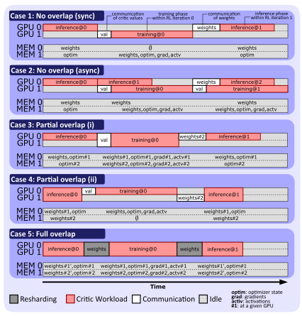

# Node-Level Cost and Memory Model

To schedule and score the executable graph $\hat{G}$ resulting from the [lowering pass](../passes/README.md#lowering), two things are necessary: a time estimate for each node and a memory-feasibility check for each device:
- a node-level time map $\mathcal T : \hat{V} \to \mathbb{R}\_{\ge 0}$ that assigns an execution-time estimate to every node in $\hat{G}$, derived from an analytical model of compute, communication, pipeline overhead, and the hierarchical network topology of the target cluster.
- a memory-feasibility predicate $\text{MemFeasible}(C)$ that checks whether the peak memory demand on every device fits within GPU capacity.

Unlike profiling-based approaches such as [ReaL](https://github.com/openpsi-project/ReaLHF), which measure actual model layers on the target hardware and interpolate between profiled configurations, our cost model derives execution-time and memory estimates analytically using a small set of hardware constants obtained via micro-benchmarks.
This makes the model independent of the specific models being optimized and avoids the per-model profiling overhead that scales with cluster size.
Together, these form the input to the [scheduler](../schedule/README.md), which constructs a resource-aware schedule and derives the throughput score.

Both the time model and the memory model rest on the following **assumptions**.
We assume mixed-precision training with BF16 parameters and FP32 Adam optimizer state.
Activation checkpointing is used by default.
The variable [activation_checkpointing](../model/memory.py#L203) selects whether recomputation and the reduced activation footprint apply.
Optimizer state and gradients are sharded by default across data-parallel ranks via ZeRO-2 (the time model includes the ReduceScatter and AllGather communication cost, and the memory model divides the optimizer footprint by $P_d$).
Runtime planning also supports replicated Adam and ZeRO-1.
The selected policy changes both memory accounting and DP collectives.
CPU offloading is not modeled.
Parameter counts cover the dominant weight matrices (attention projections, FFN, embeddings, and task heads); biases and normalization parameters are omitted as they contribute negligibly at the model scales of interest.


## Parameterization

The cost model is parameterized by three groups of inputs: workload, model architecture, and hardware.
The first two are specified by the user.
Hardware parameters are obtained via an [automated calibration suite](#automated-calibration) that runs micro-benchmarks on the target cluster.

The **[workload](workload.py)** $\mathcal W = (B, K, S, T)$ specifies batch size, rollouts per prompt, prompt length, and generation length.

For each model $m \in M$, the **[Transformer architectural specification](models.py)** $\mathcal S$ includes the number of layers $L_m$, hidden dimension $d_m$, feed-forward dimension $d_{\mathrm{ff},m}$, vocabulary size $V$, attention head dimension $d_{h,m}$, and working precision $s_b$ (Bytes per scalar; 2 for BF16).


### Hardware

The [hardware specification](hardware.py) $\mathcal H$ describes both the device topology and the measured performance characteristics of the target system.
The [topology](../core/types.py#L207) (rack count $R$, nodes per rack $N$, GPUs per node $G$) is user-specified.
All other parameters are obtained via calibration, because nominal hardware specifications (e.g., vendor-reported peak throughput or link bandwidth) do not reflect the effective performance that real workloads achieve under a given hardware and software stack:
- **Compute.** Workload-effective throughput $F_\mathrm{peak}$ (FLOP/s per GPU) and HBM bandwidth $\mathrm{BW}\_\mathrm{mem}$ (Bytes/s per GPU). These are measured with actual Transformer operations (e.g. forward pass) rather than synthetic peak benchmarks, capturing the effective compute ceiling that the cost model can rely on.
- **Communication.** Separate $(\alpha, \beta)$ parameters for collective operations (AllReduce, ReduceScatter, AllGather) and point-to-point (P2P) transfers (pipeline send/recv). Collectives use NCCL's switch-fabric algorithms and achieve higher aggregate bandwidth than single-link P2P transfers; conflating the two would systematically mispredict one class. Each type is measured at three tiers:
    - $(\alpha^\mathrm{coll}\_g, \beta^\mathrm{coll}\_g)$ and $(\alpha^\mathrm{p2p}\_g, \beta^\mathrm{p2p}\_g)$: intra-node,
    - $(\alpha^\mathrm{coll}\_n, \beta^\mathrm{coll}\_n)$ and $(\alpha^\mathrm{p2p}\_n, \beta^\mathrm{p2p}\_n)$: inter-node (intra-rack),
    - $(\alpha^\mathrm{coll}\_r, \beta^\mathrm{coll}\_r)$ and $(\alpha^\mathrm{p2p}\_r, \beta^\mathrm{p2p}\_r)$: inter-rack.
- **GEMM efficiency.** General matrix multiplication (GEMM) operations dominate Transformer compute. At small batch sizes or high TP degrees, not all GPU streaming multiprocessors (SMs) are saturated. Two calibrated constants capture this: $\gamma_M$ for the batch dimension and $\gamma_K$ for the hidden dimension that shrinks under tensor parallelism.
- **Non-GEMM overhead.** A calibrated per-layer constant $c_\mathrm{ng}$ capturing time spent on operations not included in the GEMM work formulas (normalization, positional embeddings, FlashAttention, activation functions). These operations are memory-bandwidth-bound rather than compute-bound: at high TP degrees, GEMM time shrinks but non-GEMM time stays roughly constant, so ignoring it would increasingly underestimate per-layer latency. Measured at a reference batch size.
- **Memory.** Per-GPU HBM capacity $M_\mathrm{GPU}$.


## Automated Calibration

All performance parameters are measured by an automated calibration suite that runs on the target system in approximately three minutes.
The suite executes seven micro-benchmarks:
1. NCCL AllReduce sweeps at varying message sizes $\to$ collective $(\alpha, \beta)$,
2. NCCL send/recv $\to$ P2P $(\alpha, \beta)$,
3. forward pass with actual Transformer operations $\to$ $F_\mathrm{peak}$,
4. large contiguous HBM copy $\to$ $\mathrm{BW}\_\mathrm{mem}$,
5. GEMM sweep over batch sizes $\to$ SM-utilization constant $\gamma_M$,
6. CUDA-graph decode-step timing
7. non-GEMM layer timing at a reference batch size $\to$ per-layer constant $c_\mathrm{ng}$.

The output is a hardware YAML file that is passed to the optimizer alongside the user-specified workload and model specifications.
Inter-rack latency and inverse bandwidth are estimated as twice their cross-node values.
Notably, the calibration suite measures only hardware constants – no target-workload profiling is performed and no runtime measurements are interpolated from.


## Communication Model

Communication cost in the executable graph arises from two sources:
- **Inter-operator transfers**, represented by *Comm* and *Reshard* nodes in $\hat{G}$.
- **Intra-operator communication**, induced by the 3D parallel strategy $\Pi(v)$ (e.g., TP AllReduce, DP gradient synchronization) and accounted for as part of *Op*-node execution time.

We model all communication using the standard $\alpha–\beta$ abstraction.
For a message of $M$ Bytes between two endpoints, the transfer time is
```math
T(M) = \alpha + \beta \cdot M,
```
where $\alpha$ is the per-message latency and $\beta$ is the inverse bandwidth (seconds per Byte).


### Tier Selection

The $(\alpha, \beta)$ parameters depend on the physical placement of the communicating devices.
We distinguish three tiers: intra-node, inter-node (within a rack), and inter-rack, and select the tier based on the span of the participating allocations.
When a communication operation spans multiple tiers, the slowest (most conservative) tier is used.
As noted earlier, the cost model maintains separate $(\alpha, \beta)$ parameters for collective and P2P operations at each tier.


### Communication Primitives

Given $p$ participating GPUs and per-GPU message size $M$ Bytes, the following table reports the communication cost of each primitive.
Collectives use $(\alpha^\mathrm{coll}, \beta^\mathrm{coll})$; P2P uses $(\alpha^\mathrm{p2p}, \beta^\mathrm{p2p})$, each at the appropriate tier.

<div align="center">

| Primitive     | Time                                                                   | Application                   |
| --------------|------------------------------------------------------------------------|-------------------------------|
| AllReduce     | $2(p{-}1)\alpha^\mathrm{coll} + 2\tfrac{p-1}{p}M\,\beta^\mathrm{coll}$ | TP partial-result aggregation |
| AllGather     | $(p{-}1)\alpha^\mathrm{coll} + \tfrac{p-1}{p}M\,\beta^\mathrm{coll}$   | ZeRO-2 weight gather          |
| ReduceScatter | $(p{-}1)\alpha^\mathrm{coll} + \tfrac{p-1}{p}M\,\beta^\mathrm{coll}$   | ZeRO-2 gradient reduce        |
| AlltoAll      | $(p{-}1)\alpha^\mathrm{coll} + M\,\beta^\mathrm{coll}$                 | *Reshard* nodes               |
| P2P           | $\alpha^\mathrm{p2p} + M\,\beta^\mathrm{p2p}$                          | PP send/recv, *Comm* nodes    |

</div>

All collectives assume ring-based implementations.


## Node Cost

This section defines $\mathcal T(v)$ for each [node](cost.py#L34) $v \in \hat{V}$.
*Comm* and *Reshard* nodes are costed by payload and communication tier.


### Operator Nodes

For *Op* nodes, which dominate execution time, the cost model uses a [five-component decomposition](cost.py#L90), specifically for an *Op* node $v \in \hat{V}$ with parallel strategy $\Pi(v) = (P_d, P_p, P_t)$ and microbatch count $\mathrm{mb}(v)$,
```math
\mathcal T(v) = T_\mathrm{gemm}(v) + T_\mathrm{bubble}(v) + T_\mathrm{comm}(v) + T_\mathrm{non\text{-}gemm}(v) + T_\mathrm{opt}(v),
```
where:
- $T_\mathrm{gemm}$: GEMM compute time under roofline-aware effective throughput,
- $T_\mathrm{bubble}$: pipeline bubble overhead,
- $T_\mathrm{comm}$: intra-operator communication induced by 3D parallel strategy,
- $T_\mathrm{non\text{-}gemm}$: overhead from non-GEMM operations (normalization, positional embeddings, FlashAttention, activations),
- $T_\mathrm{opt}$: Adam optimizer step cost (training nodes only).

A naive cost model would estimate $\mathcal T(v) \approx W(v) / (P \cdot F_\mathrm{peak})$, where $W(v)$ is the total FLOP count and $P = P_d P_p P_t$ is the device count.
This single-formula approach fails in three regimes that are common in RLM training workloads.
First, at small per-device batch sizes (high data parallelism or small $B$), GPU SMs are not fully saturated and effective throughput drops well below $F_\mathrm{peak}$; the [GEMM efficiency model](#gemm-compute) captures this.
Second, [non-GEMM operations](#non-gemm-overhead) (normalization, attention, activation functions) are memory-bandwidth-bound and do not scale with tensor parallelism: at high TP degrees, GEMM time shrinks but non-GEMM time stays constant, causing the naive model to increasingly underestimate latency as TP grows.
Third, the Adam parameter update reads and writes $18$ Bytes per parameter and is entirely memory-bandwidth-bound; ignoring it underestimates training-node latency, particularly for small models where the [optimizer step](#optimizer-step) is a significant fraction of the total.


#### GEMM Compute

Under 3D parallelism, each *Op* node's computation is distributed across $P = P_d \cdot P_p \cdot P_t$ devices.
The GEMM compute time estimates how long the matrix multiplications take on a single device, assuming ideal load balancing:
```math
T_\mathrm{gemm}(v) = \frac{W(v)}{F_\mathrm{eff}(v) \cdot P},
```
where $W(v)$ is the total FLOP count of operator $v$ (summed across all devices) and $F_\mathrm{eff}(v)$ is the effective per-device throughput, which accounts for both the memory-bandwidth ceiling and SM underutilization.
[Pipeline bubble overhead](#pipeline-bubble) is handled separately by $T_\mathrm{bubble}$.

**Work formulas.**
The [FLOP count](cost.py#L481) $W(v)$ depends on the operator's role (generation, inference, or training) and the model being invoked.
We use the standard Transformer work model, extended with model-specific output heads and the quadratic attention term.
We summarize $W(v)$ in the following table for each role–model combination.

Each layer of a Transformer with hidden dimension $d_m$ and FFN dimension $d_{\mathrm{ff},m}$ performs approximately $2(4d_m^2 + 2d_m d_{\mathrm{ff},m})$ FLOP per token for the FFN and projection GEMMs, plus $2 \cdot \ell \cdot d_m$ FLOP per token for the attention computation, where $\ell$ is the context length (the number of past tokens the attention mechanism attends to).
On top of the $L_m$ Transformer layers, each forward pass applies an output projection head whose cost depends on the model type.

The table below shows FLOP count per operator role and model. Generation splits into prefill (first term) and decode (second term); decode uses average context length $S + T/2$.
Training uses a $4\times$ multiplier (forward + recompute forward + backward), when activation checkpointing is enabled, and $3\times$ if disabled.
Actor/reference heads apply an unembedding projection ($2Vd$) per token; the critic/value head applies a per-token scalar projection ($2d$); the reward head applies a per-sequence scalar projection ($2d$ total, not per token).
| Role       | Model                          | Work $W(v)$                                                                                                                                                        |
|------------|--------------------------------|--------------------------------------------------------------------------------------------------------------------------------------------------------------------|
| Generation | $\pi_\theta$                   | $BK\bigl[S \cdot 2L_\pi(4d_\pi^2 {+} 2d_\pi d_{\pi\mathrm{ff}} {+} S d_\pi) + 2V d_\pi\bigr] + BK\bigl[2(T{-}1)L_\pi(4d_\pi^2 {+} 2d_\pi d_{\pi\mathrm{ff}} {+} (S{+}\tfrac{T}{2})d_\pi) + 2(T{-}1)V d_\pi\bigr]$ |
| Inference  | $\pi_\theta, \pi_\mathrm{ref}$ | $BK(S{+}T)\bigl[2L_m(4d_m^2 {+} 2d_m d_{\mathrm{ff},m} {+} (S{+}T)d_m) + 2V d_m\bigr]$                                                                             |
| Inference  | $V_\psi, \pi_\mathrm{AC}$      | $BK(S{+}T)\bigl[2L_m(4d_m^2 {+} 2d_m d_{\mathrm{ff},m} {+} (S{+}T)d_m) + 2d_m\bigr]$                                                                               |
| Inference  | $R_\varphi$                    | $BK(S{+}T) \cdot 2L_m(4d_m^2 {+} 2d_m d_{\mathrm{ff},m} {+} (S{+}T)d_m) + BK \cdot 2d_m$                                                                           |
| Training   | $\pi_\theta$                   | $4 \cdot BK(S{+}T)\bigl[2L_\pi(4d_\pi^2 {+} 2d_\pi d_{\pi\mathrm{ff}} {+} (S{+}T)d_\pi) + 2V d_\pi\bigr]$                                                          |
| Training   | $V_\psi$                       | $4 \cdot BK(S{+}T)\bigl[2L_V(4d_V^2 {+} 2d_V d_{V\mathrm{ff}} {+} (S{+}T)d_V) + 2d_V\bigr]$                                                                        |
| Training   | $\pi_\mathrm{AC}$              | $4 \cdot BK(S{+}T)\bigl[2L_\mathrm{AC}(4d_\mathrm{AC}^2 {+} 2d_\mathrm{AC} d_{\mathrm{AC,ff}} {+} (S{+}T)d_\mathrm{AC}) + 2V d_\mathrm{AC} + 2d_\mathrm{AC}\bigr]$ |

**Roofline model.**
A Transformer layer's execution time is bounded by either the rate at which the GPU can perform arithmetic (compute-bound) or the rate at which it can load weights and activations from HBM (memory-bandwidth-bound).
Which regime applies depends on the arithmetic intensity $I$: the ratio of FLOP to Bytes of HBM traffic.
When $I$ exceeds the hardware ridge point $I^\ast = F_\mathrm{peak} / \mathrm{BW}\_\mathrm{mem}$, the operator is compute-bound; below it, execution is limited by memory bandwidth.
Large batch sizes push operations into the compute-bound regime (many FLOP per weight load); small batches or autoregressive decode steps are typically memory-bound.

The effective per-device throughput is
```math
F_\mathrm{eff}(v) =
\begin{cases}
F_\mathrm{peak}\eta(v), & I(v) \ge F_\mathrm{peak}/\mathrm{BW}_\mathrm{mem}, \\
I(v)\mathrm{BW}_\mathrm{mem}, & \text{otherwise}.
\end{cases}
```
where $\eta(v)$ is the GEMM efficiency and $I(v)$ is the arithmetic intensity.
It switches at the unadjusted hardware ridge point and applies GEMM efficiency only in the compute branch.

The $\min$ selects the tighter of two ceilings: the first term $F_\mathrm{peak} \cdot \eta$ is the maximum FLOP/s the compute units can sustain (reduced by SM underutilization); the second term $I \cdot \mathrm{BW}\_\mathrm{mem}$ is the maximum FLOP/s that the memory system can feed, given how many FLOP are performed per Byte loaded.

**Arithmetic intensity.**
For inference and training operators processing sequences of length $\ell = S + T$, the per-device [arithmetic intensity](cost.py#L406) is
```math
I(v) = \frac{W_\mathrm{dev}(v)}{\Omega_W + \Omega_A},
```
where $W_\mathrm{dev}(v) = W(v) / (P \cdot \mathrm{mb})$ is the per-device FLOP for one microbatch and the denominator captures the HBM traffic:
```math
\begin{align}
\Omega_W &= \frac{L_m}{P_p \cdot P_t}\bigl(4d_m^2 + 2 d_m d_{\mathrm{ff},m}\bigr) \cdot s_b \text{(weights),} \\
\Omega_A &= 2 \, b_\mathrm{local} \cdot \ell \cdot d_m \cdot \frac{L_m}{P_p} \cdot s_b \text{(activations),}
\end{align}
```
with $b_\mathrm{local} = BK / (P_d \cdot \mathrm{mb})$ sequences per device per microbatch.

The arithmetic intensity determines whether an operator is limited by compute throughput or by HBM bandwidth.
$\Omega_W$ is fixed per microbatch (model weights are loaded once regardless of batch size), while $\Omega_A$ grows linearly with $b_\mathrm{local}$.
At large batch sizes, FLOP grow faster than HBM traffic, pushing $I$ above the ridge point into the compute-bound regime.
At small batch sizes (e.g., high $P_d$ splitting a small $B$), weight loading dominates and the operator becomes memory-bound with throughput limited by $\mathrm{BW}\_\mathrm{mem}$.
This distinction matters for the optimizer: adding more data-parallel devices can push an operator from compute-bound into memory-bound territory, making further parallelism counterproductive.

**Training and generation.**
For training operators, the $4\times$ work multiplier (forward + recompute + backward) applies equally to FLOP and to HBM traffic, so the ratio $I = \text{FLOP} / \text{Bytes}$ is the same as for a single forward pass.
We therefore use the same intensity formula for both inference and training.
Generation is handled differently: it splits into a compute-bound prefill phase ($\ell = S$) and a memory-bandwidth-bound decode phase ($\ell = 1$ per step).
The cost model computes $F_\mathrm{eff}$ separately for each phase using phase-specific arithmetic intensities, then derives the total generation time as the sum of both phase times.

**GEMM efficiency.**
The roofline ceiling $F_\mathrm{peak}$ assumes all GPU SMs are fully saturated.
In practice, utilization depends on the GEMM dimensions: a small per-device batch produces narrow matrices that leave SMs idle, and high TP degrees shrink the hidden dimension per device.
We [model](cost.py#L291) this with two multiplicative factors:
```math
\eta(v) = \frac{b_\mathrm{local} \cdot \ell}{b_\mathrm{local} \cdot \ell + \gamma_M}
\;\cdot\;
\frac{\min(d_m / P_t,\; d_{\mathrm{ff},m} / P_t)}{\min(d_m / P_t,\; d_{\mathrm{ff},m} / P_t) + \gamma_K},
```
where the first factor captures batch-size underutilization (the product $b_\mathrm{local} \cdot \ell$ is the number of rows in the dominant GEMMs) and the second factor captures TP-induced narrowing of the column dimension.

Both factors follow a saturating curve, approaching $\eta = 1$ when the dimension is large relative to $\gamma$ and dropping toward zero when it is small.

The constants $\gamma_M$ and $\gamma_K$ are hardware-specific and obtained via [calibration](#automated-calibration).
The constants $\gamma_M$ and $\gamma_K$ are hardware-specific, however only $\gamma_K$ is obtained via [calibration](#automated-calibration).
$\gamma_K$ defaults to zero unless the user specifies a different value.
For example, on an Nvidia A100 80GB we measure $\gamma_M \approx 123$, meaning that a batch-sequence product below roughly 120 incurs measurable SM underutilization.
If $\gamma_K$ is not calibrated (set to zero), the second factor defaults to one and no TP penalty is applied.


#### Pipeline Bubble

With pipeline parallelism ($P_p > 1$), the $P_p$ stages process $\mathrm{mb}$ microbatches in a pipelined fashion.
Under a 1F1B schedule, each stage spends $P_p - 1$ slots idle (during pipeline fill and drain) out of $\mathrm{mb} + P_p - 1$ total slots.
Equivalently, the combined GEMM and bubble time can be written as
```math
T_\mathrm{gemm}(v) + T_\mathrm{bubble}(v)
= \frac{W(v)}{F_\mathrm{eff}(v) \cdot P}
\;\cdot\;
\left (\frac{\mathrm{mb}(v) + P_p - 1}{\mathrm{mb}(v)}\right ),
```
where the fraction $(\mathrm{mb} + P_p - 1) / \mathrm{mb}$ is the pipeline bubble factor.
When $P_p = 1$, this factor is $1$ and there is no bubble overhead.
Increasing the microbatch count $\mathrm{mb}$ pushes the factor toward $1$, which is why the optimizer treats $\mathrm{mb}$ as a search variable.


#### Intra-Operator Communication

The third component $T_\mathrm{comm}(v)$ captures the [communication](cost.py#L538) induced by the 3D parallel strategy within a single operator.
Three types of communication arise: TP AllReduce for partial-result aggregation within each layer, PP P2P for activation transfer between pipeline stages, and DP gradient synchronization across data-parallel replicas (training only).
The combined 3D formulas are presented directly, from which individual DP, PP, and TP formulas follow as special cases.

**TP AllReduce.**
Each Transformer layer requires two AllReduce operations (one after the attention block, one after the FFN block) to aggregate partial results across the $P_t$ tensor-parallel ranks.
Since RPEG's search space restricts TP to intra-node placement, TP AllReduces always use $(\alpha^\mathrm{coll}\_g, \beta^\mathrm{coll}\_g)$.

Because all $P_d \cdot P_p \cdot P_t$ devices run concurrently, the per-vertex time $\mathcal T(v)$ reduces to the wall-clock time of a single device.
On that device, AllReduces occur twice per layer and once per microbatch, giving $2 \cdot L_m / P_p$ AllReduces per microbatch across the $L_m / P_p$ layers assigned to the device's pipeline stage, repeated $\mathrm{mb}$ times.
For inference ($\ell = S + T$), the per-device TP cost is
```math
T_\mathrm{tp}(v) = 2 \cdot \frac{L_m}{P_p} \cdot \mathrm{mb}
\cdot T_\mathrm{AllReduce}\left (\frac{BK \cdot \ell \cdot d_m \cdot s_b}{P_d \cdot \mathrm{mb}},\, P_t \right ),
```
where $T_\mathrm{AllReduce}(M, p)$ is the AllReduce cost from the [table](#communication-primitives) above.
For training, the count increases to $6 \cdot L_m / P_p \cdot \mathrm{mb}$ (two AllReduces per layer for each of the forward, recomputed forward, and backward passes under activation checkpointing).
For generation, prefill ($\ell = S$) and decode ($\ell = 1$ per step) contribute separately.

Note that $\mathrm{mb}$ cancels in the bandwidth term but not in the latency term, so increasing $\mathrm{mb}$ adds latency from additional round-trips.

**PP P2P.**
Pipeline stages exchange activation tensors via P2P send/recv.
A pipeline with $P_p$ stages has $P_p - 1$ consecutive stage boundaries.
Under a nested placement, TP groups fill each node first and PP stages span across nodes, so some boundaries are intra-node while others cross nodes.
The cost model weights each step by the fraction of boundaries at each tier.
With $G / P_t$ stages packed per node, $\lceil P_p / (G/P_t) \rceil - 1$ boundaries are inter-node and the rest are intra-node. For inference:
```math
T_\mathrm{pp}(v) = (\mathrm{mb} + P_p - 2) \cdot \Bigl[\tfrac{n_\mathrm{intra}}{P_p - 1}\,(\alpha^\mathrm{p2p}_g + M_\mathrm{pp}\,\beta^\mathrm{p2p}_g)
+\; \tfrac{n_\mathrm{inter}}{P_p - 1}\,(\alpha^\mathrm{p2p}_\mathrm{tier} + M_\mathrm{pp}\,\beta^\mathrm{p2p}_\mathrm{tier}) \Bigr],
```
where $M_\mathrm{pp} = BK \cdot \ell \cdot d_m \cdot s_b / (P_d \cdot P_t \cdot \mathrm{mb})$ is the per-microbatch activation size (TP-sharded), $\mathrm{mb} + P_p - 2$ is the number of pipeline communication steps, and $n_\mathrm{intra} + n_\mathrm{inter} = P_p - 1$.
When $P_p = 1$, $T_\mathrm{pp}$ is $0$, since there are no pipeline boundaries.
The inter-node tier is determined by the allocation extent. For training under a 1F1B schedule, the pipeline depth increases to $\mathrm{mb} + 2P_p - 3$.

**DP Gradient Synchronization (Training Only).**
Under ZeRO-2, gradient synchronization uses ReduceScatter followed by AllGather rather than a single AllReduce. Each collective operates on the parameter shard local to the DP group: $T_\mathrm{dp}(v) = T_\mathrm{ReduceScatter}\left( \frac{\\#W_m\cdot s_b}{P_p \cdot P_t}, P_d\right) + T_\mathrm{AllGather}\left(\frac{\\#W_m \cdot s_b}{P_p \cdot P_t}, P_d\right)$, where $\\#W_m$ is the total parameter count of model $m$, so that $\\#W_m \cdot s_b / (P_p \cdot P_t)$ is the BF16 gradient shard size per DP group.
Both collectives use collective $(\alpha^\mathrm{coll}, \beta^\mathrm{coll})$ at the tier of the full allocation (conservatively, the slowest link in the DP group).
Generation and inference operators have no DP communication.

**Intra-Operator Communication Cost**
The total intra-operator communication is
```math
T_\mathrm{comm}(v) = T_\mathrm{tp}(v) + T_\mathrm{pp}(v) + T_\mathrm{dp}(v),
```
where $T_\mathrm{dp} = 0$ for generation and inference.

The following table summarizes the communication components per role.
All primitive costs are defined in the [table](#communication-primitives) above.
TP uses collective intra-node parameters; PP step cost uses the weighted ntra/inter-node tiers; DP uses the tier of the full allocation.
$\dagger$: generation uses $\ell{=}S$ during prefill and $\ell{=}1$ per decode step.

<div align="center">

| Role       | Parallelism | Primitive     | Count (per GPU)                  | Message size                                                                         |
|------------|-------------|---------------|----------------------------------|--------------------------------------------------------------------------------------|
| Generation | TP          | AllReduce     | $2 \tfrac{L_m}{P_p} \mathrm{mb}$ | $\tfrac{BK \cdot \ell \cdot d_m \cdot s_b}{P_d \cdot \mathrm{mb}}^\dagger$           |
| Generation | PP          | P2P           | $\mathrm{mb} {+} P_p {-} 2$      | $\tfrac{BK \cdot \ell \cdot d_m \cdot s_b}{P_d \cdot P_t \cdot \mathrm{mb}}^\dagger$ |
| Inference  | TP          | AllReduce     | $2 \tfrac{L_m}{P_p} \mathrm{mb}$ | $\tfrac{BK(S{+}T) d_m \, s_b}{P_d \cdot \mathrm{mb}}$                                |
| Inference  | PP          | P2P           | $\mathrm{mb} {+} P_p {-} 2$      | $\tfrac{BK(S{+}T) d_m \, s_b}{P_d \cdot P_t \cdot \mathrm{mb}}$                      |
| Training   | TP          | AllReduce     | $6 \tfrac{L_m}{P_p} \mathrm{mb}$ | $\tfrac{BK(S{+}T) d_m \, s_b}{P_d \cdot \mathrm{mb}}$                                |
| Training   | PP          | P2P           | $\mathrm{mb} {+} 2P_p {-} 3$     | $\tfrac{BK(S{+}T) d_m \, s_b}{P_d \cdot P_t \cdot \mathrm{mb}}$                      |
| Training   | DP          | ReduceScatter | $1$                              | $\tfrac{\\#W_m \cdot s_b}{P_p \cdot P_t}$                                            |
| Training   | DP          | AllGather     | $1$                              | $\tfrac{\\#W_m \cdot s_b}{P_p \cdot P_t}$                                            |

</div>


#### Non-GEMM Overhead

The [GEMM work formulas](#gemm-compute) count only matrix multiplication FLOP.
Each Transformer layer also executes non-GEMM operations – normalization, positional embeddings, FlashAttention score computation, and activation functions – which are memory-bandwidth-bound due to their low arithmetic intensity.
At $P_t = 1$, these operations are implicitly absorbed into the calibrated $F_\mathrm{peak}$, since the calibration benchmark runs without tensor parallelism and therefore includes non-GEMM time in its throughput measurement.
At $P_t > 1$, however, GEMM time shrinks by $1/P_t$ while TP-invariant operations (normalization, residual additions) do not scale, creating a growing discrepancy.
The cost model captures this via a calibrated per-layer constant $c_\mathrm{ng}$ (seconds per layer).
The [additional overhead](cost.py#L212) beyond what $F_\mathrm{peak}$ already absorbs is:
```math
T_\mathrm{non\text{-}gemm}(v) =
\underbrace{\frac{L_m}{P_p}}_{\text{layers/stage}}
\cdot\;
\underbrace{c_\mathrm{ng} \cdot \left(1 - \frac{1}{P_t}\right)}_{\text{excess at } P_t > 1}
\cdot\;
\underbrace{\frac{b_\mathrm{local}}{B_\mathrm{cal}}}_{\text{batch scaling}},
```
where $B_\mathrm{cal}$ is the per-device batch size used during [calibration](#automated-calibration) of $c_\mathrm{ng}$.
For training, the result is multiplied by $4$ (forward + recompute + backward passes) with checkpointing, or $3$ without it.
At $P_t = 1$, the factor $(1 - 1/P_t) = 0$ and no overhead is added, confirming that non-GEMM cost is fully absorbed by $F_\mathrm{peak}$ when tensor parallelism is not used.
For generation operators, $T_\mathrm{non\text{-}gemm} = 0$: decode steps process a single token per step, making their non-GEMM contribution negligible relative to the KV-cache loading cost that dominates decode latency.


#### Optimizer Step

For training operators, the Adam optimizer reads the FP32 master weight, first moment, second moment, and BF16 gradient, computes the update, and writes back the updated master weight, moments, and a BF16 weight cast.
Each parameter therefore occupies 18 Bytes of optimizer state (4 FP32 master + 4 FP32 $m_1$ + 4 FP32 $m_2$ + 4 FP32 gradient + 2 BF16 weight), and we approximate the per-parameter HBM traffic by this storage footprint.
The [optimizer step](cost.py#L115) is entirely memory-bandwidth-bound: $T_\mathrm{opt}(v) = \frac{\\#W_m}{P_d \cdot P_p \cdot P_t} \cdot \frac{18}{\mathrm{BW}\_\mathrm{mem}}$, where $\\#W_m / (P_d \cdot P_p \cdot P_t)$ is the number of parameters per device.
For generation and inference operators, $T_\mathrm{opt}$ is $0$.


### Communication and Resharding Nodes

**Comm Nodes**
A [*Comm* node](cost.py#L446) $c$ is inserted on an edge $x_{u,k} \to x_{v,k}$ (or a publication edge $x_{u,k'} \to x_{v,k}$) when the source and destination operators are placed on different allocations $\sigma(u) \neq \sigma(v)$.
The transferred container $a$ has a Byte volume of $\\#a \cdot s(a)$.
NCCL executes such transfers as concurrent P2P send/recv pairs; since all pairs run in parallel, the transfer time is limited by whichever side has fewer devices: $T_\mathrm{comm}(u, v, a) = \alpha^\mathrm{p2p} + \frac{\\#a \cdot s(a)}{\min(|\sigma(u)|,\, |\sigma(v)|)} \cdot \beta^\mathrm{p2p}$, where $(\alpha^\mathrm{p2p}, \beta^\mathrm{p2p})$ are the P2P latency and inverse bandwidth at the tier spanned by $\sigma(u)$ and $\sigma(v)$.

**Reshard Nodes**
A [*Reshard* node](cost.py#L464) $r$ is inserted between two consecutive operators $u, v$ of the same model $m$ when $\sigma(u) = \sigma(v)$ but $\Pi(u) \neq \Pi(v)$ (same devices, different parallel layout).
All $|\sigma(u)|$ devices participate symmetrically in the layout transformation: $T_\mathrm{reshard}(u, v, m) = T_\mathrm{AlltoAll}\left(\frac{\\#W_m \cdot s_b}{|\sigma(u)|}, |\sigma(u)|\right)$, where $\\#W_m \cdot s_b$ is the full parameter size of model $m$ in Bytes and the AlltoAll uses collective $(\alpha^\mathrm{coll}, \beta^\mathrm{coll})$ at the tier of $\sigma(u)$.


### Summary: Time Map

With the cost of all three node types defined, the complete time map can be stated now.
The time map $\mathcal T : \hat{V} \to \mathbb{R}\_{\ge 0}$ assigns each node in the executable graph an execution-time estimate:
1. *Op* node $v$: $\mathcal T(v)$.
2. *Comm* node $c$ inserted on edge $(u \xrightarrow{a} v)$: $\mathcal T(c) = T_\mathrm{comm}(u, v, a)$.
3. *Reshard* node $r$ for model $m$ between $u, v$: $\mathcal T(r) = T_\mathrm{reshard}(u, v, m)$.


## Memory Cost

Many configurations that score well under the cost model of the preceding sections are infeasible in practice because one or more GPUs exceed their HBM capacity.
Rather than discovering this only at runtime, the optimizer uses an analytical memory model to filter infeasible strategies from the [candidate directory](../search/README.md#move-proposals) and to apply a soft penalty to near-feasible plans during [search](../search/README.md#energy-based-formulation).

The [memory model](memory.py#L189) operates under the same assumptions stated at the beginning (mixed-precision BF16/FP32, activation checkpointing, ZeRO-2 optimizer sharding, no CPU offloading).

To ensure that the optimizer does not propose plans that would cause out-of-memory failures (OOM) at runtime, the effective per-GPU capacity reserves a configurable fraction $\varepsilon_\mathrm{rt}$ for runtime overhead and fragmentation and is set to $0.10$ by default:
```math
M_{\mathrm{eff}} = (1-\varepsilon_{\mathrm{rt}})\,M_{\mathrm{GPU}}.
```

### Parameter Accounting

The following table summarizes the dominant weight matrix counts per [model variant](models.py).
Counts include attention projections ($4d^2$), FFN ($2d\,d_\mathrm{ff}$), embeddings ($Vd$), and model-specific heads ($d$ for critic/reward/AC-share).
By default, for actor and reference models the input and output embeddings are tied (shared $Vd$ matrix), but under pipeline parallelism both the first and last stage store a physical copy.

<div align="center">

| Model                                             | Parameter count                         |
|---------------------------------------------------|-----------------------------------------|
| Actor $\pi_\theta$ / Reference $\pi_\mathrm{ref}$ | $L(4d^2 + 2d d_{\mathrm{ff}}) + Vd$     |
| Shared Actor-Critic $\pi_{\mathrm{AC}}$           | $L(4d^2 + 2d d_{\mathrm{ff}}) + Vd + d$ |
| Critic $V_\psi$ / Reward $R_\varphi$              | $L(4d^2 + 2d d_{\mathrm{ff}}) + Vd + d$ |

</div>

For a model $m$ with architecture $(L_m, d_m, d_{m,\mathrm{ff}})$, the per-layer parameter count is
```math
W_m^{\mathrm{layer}} = 4d_m^2 + 2d_m \, d_{m,\mathrm{ff}}.
```

**Pipeline Stage Partitioning.**
Under pipeline parallelism with degree $P_p$ (constrained to divide $L_m$), each stage receives $L_m / P_p$ Transformer layers.
Embeddings and task heads are not uniformly distributed: the input embedding $E_m = V d_m$ resides on the first stage, while the output head resides on the last stage.
For actor and reference models, the last stage also stores a full output matrix of size $Vd$.
For critic and reward models, the last stage stores only a scalar head of size $d_m$.

We model Tensor parallelism, so that it shards Transformer layer weights across TP ranks, however embeddings and task heads are replicated in full on each rank.
This asymmetry matters for memory accounting because the non-sharded components (especially the embedding with $V \cdot d$ parameters) can dominate the per-GPU footprint at large vocabulary sizes.
We therefore separate the per-stage parameter count into a TP-sharded component $W_m^\mathrm{split}$ (Transformer layers) and a replicated component $W_m^\mathrm{nonsplit}$ (embeddings, heads):
```math
\begin{aligned}
W_m^{\mathrm{split}}(p) &= \frac{L_m}{P_p} \cdot W_m^{\mathrm{layer}}, \\
W_m^{\mathrm{nonsplit}}(p) &= \underbrace{\mathbb{I}[p{=}1] \cdot E_m}_{\text{input embedding}} \;+\; \underbrace{\mathbb{I}[p{=}P_p] \cdot (E_m + H_m)}_{\text{output projection (model-dependent)}},
\end{aligned}
```
where $p \in \{1, \ldots, P_p\}$ is the pipeline stage index.
On the last stage, actor, reference, and AC-share models store the tied output embedding ($E_m$), while critic, reward, and AC-share models store a scalar value head ($H_m = d_m$).
Models that lack the respective component set the corresponding term to zero.
Embeddings and heads are pinned to specific stages, making the first and last stages the memory bottleneck in most configurations.

**Per-GPU Weight Shard.**
Since all GPUs in a homogeneous cluster share the same memory capacity, the binding constraint is the pipeline stage with the largest total footprint.
The per-GPU parameter count on that worst-case stage is
```math
W_{\mathrm{shard}}(v)
=
\frac{W_m^{\mathrm{split,max}}}{P_t(v)} + W_m^{\mathrm{nonsplit,max}},
```
where $(W_m^\mathrm{split,max}, W_m^\mathrm{nonsplit,max})$ are taken from the stage that maximizes $W_m^\mathrm{split}(p) + W_m^\mathrm{nonsplit}(p)$.
Transformer layers are divided by $P_t$ while embeddings and heads are replicated on each TP rank.


### Persistent Memory Components

The remaining memory components are derived from $W_\mathrm{shard}(v)$ and depend on the operator's role (generation, inference, or training).
How they interact when multiple models share a device is addressed [below](#co-residency-aware-device-peaks).

**Weights.**
Every operator stores one BF16 copy of its [weight shard](memory.py#L390):
```math
M_{\mathrm{w}}(v) = W_{\mathrm{shard}}(v) \cdot s_b \quad \text{[Bytes]}.
```

**Optimizer State (Training Only).**
For trainable operators, Adam maintains three FP32 tensors per parameter (master weights, first moment, second moment).
Under ZeRO-2, each data-parallel rank stores only $1/P_d$ of the [optimizer state](memory.py#L401):
```math
M_{\mathrm{opt}}(v) = \frac{12 \cdot W_{\mathrm{shard}}(v)}{P_d(v)} \quad \text{[Bytes]}.
```

**Gradients (Training Only).**
[Gradients](memory.py#L415) are accumulated in BF16 (the same precision as parameters). Under ZeRO-2, each rank holds $1/P_d$ of the averaged gradients after ReduceScatter:
```math
M_{\nabla}(v) = \frac{W_{\mathrm{shard}}(v) \cdot s_b}{P_d(v)} \quad \text{[Bytes]}.
```

### Transient Memory Components

The remaining components are transient: they are allocated when an operator begins executing and freed when it completes.
Which components are active depends on the operator's role.
All formulas below use the per-device microbatch size $b_\mathrm{local} = BK / (P_d \cdot \mathrm{mb})$.

**Training Activations.**
Training requires retaining intermediate [activations](memory.py#L432) for the backward pass.
Storing all layer activations simultaneously is prohibitive for deep models, so we use activation checkpointing: only every $c$-th layer's output is retained during the forward pass, and the remaining activations are recomputed from these checkpoints during the backward pass.
The optimal interval $c = \lfloor\sqrt{L_m / P_p}\rfloor$ minimizes total memory by balancing the number of stored checkpoints against the recomputation buffer size.

The memory cost has two parts.
The $\lceil (L_m/P_p) / c \rceil$ checkpoints are retained throughout the backward pass, each storing the hidden state between two consecutive segments (a tensor of width $d$, not TP-sharded).
During the backward pass for a given segment, the $c$ layers between two checkpoints must be recomputed, requiring a buffer that holds the peak intermediate activation within a single layer.
This peak is the larger of the attention intermediates ($2d + 6d/P_t$ per token) and the FFN intermediates ($2d + 2d_\mathrm{ff}/P_t$ per token).

Under the 1F1B pipeline schedule, the first $P_p$ microbatches execute their forward passes before any backward pass begins (the pipeline warmup), since a constraint guarantees $\mathrm{mb} \ge P_p$.
Each of these microbatches retains its activation checkpoints simultaneously, so the activation memory scales with the pipeline depth.
Each microbatch processes $b_\mathrm{local} = BK / (P_d \cdot \mathrm{mb})$ sequences of length $S + T$.
Combining checkpoints and recomputation buffer, the total training activation memory per GPU is
```math
M_{\mathrm{act}}(v)
= s_b \cdot P_p \cdot b_\mathrm{local} \cdot (S{+}T) \\
\cdot\;
\Bigl(
\underbrace{\left\lceil \tfrac{L_m/P_p}{c} \right\rceil \cdot d}_{\text{checkpoints}}
+\;
\underbrace{c \cdot \max\!\bigl(2d {+} \tfrac{6d}{P_t},\; 2d {+} \tfrac{2d_\mathrm{ff}}{P_t}\bigr)}_{\text{recomputation buffer}}
\Bigr)
\quad \text{[Bytes]}.
```

**Inference Activations.**
For inference and generation, only one layer's [intermediates](memory.py#L460) are alive at any time, so the footprint is determined by the peak within a single layer (the same attention and FFN peaks as in the recomputation buffer above).
On the last pipeline stage ($p = P_p$), the LM head adds a $d + V$ term that can dominate for large vocabularies.
Inference processes one microbatch at a time, so
```math
M_{\mathrm{act,inf}}(v)
=
s_b \cdot b_\mathrm{local} \cdot \ell \cdot
\max\!\bigl(2d + \tfrac{6d}{P_t},\; 2d + \tfrac{2d_\mathrm{ff}}{P_t},\; d + V\bigr)
\quad \text{[Bytes]},
```
where $\ell = S + T$ for both generation and inference (all operators process the full prompt-plus-completion sequence).

**KV Cache (Generation Only).**
Autoregressive generation maintains a [key-value cache](memory.py#L524) that grows with the sequence length.
We account for the peak at the last decode step ($S + T$ tokens).
Each Transformer layer stores one key and one value vector per token, sharded across TP and PP:
```math
M_{\mathrm{kv}}(v)
=
2 \, s_b \cdot \frac{B}{P_d} \cdot K \cdot (S{+}T) \cdot \frac{L_m}{P_p} \cdot \frac{d}{P_t}
\quad \text{[Bytes]}.
```
The factor of $2 s_b$ accounts for two caches (K and V) each stored in $s_b$ Bytes.

### Co-Residency-Aware Device Peaks

The per-operator formulas above describe the memory cost of a single operator in isolation.
In RLM training pipelines, however, multiple models typically share the same physical devices.
For example, a device may participate in actor generation, reference inference, and actor training within the same iteration.
While some memory (activations, KV cache) is allocated and freed per operator, model weights and optimizer state typically remain resident in HBM between operators to avoid the cost of repeated CPU-to-GPU transfers.
The memory feasibility check must therefore account for this [co-residency](memory.py#L608).

We split the memory on each device $d$ into a persistent component (resident for the entire schedule) and a transient component (allocated when an operator starts, freed when it completes).
The persistent footprint of a model $m$ on device $d$ depends on the role that $d$ plays for $m$.
A device can serve one of three roles for a given model:
- **Training device**: $d$ runs a training operator for $m$. The Adam optimizer state is pre-allocated once and persists. BF16 weights are cast from the FP32 masters on demand for each operator and freed afterward. Persistent cost: $12 \cdot W_\mathrm{shard}(m,d) / P_d$ (ZeRO-2 sharded).
- **Shadow device**: $d$ runs a non-training operator (e.g., generation) for a trainable model with $\tau(m) > 0$, and the training device is disjoint from $d$. The device holds a persistent BF16 shadow copy so that [generation can proceed concurrently with training](../passes#shadow-pairs). Persistent cost: $W_\mathrm{shard}(m,d) \cdot s_b$.
- **Frozen device**: $d$ runs operators for a non-trainable model (e.g., reference or reward). The BF16 weights are read-only and always resident. Persistent cost: $W_\mathrm{shard}(m,d) \cdot s_b$.

When a device runs both training and non-training operators of the same model (colocation or partial overlap), no separate shadow copy is needed: the BF16 weights are cast from the optimizer's FP32 masters before each operator and freed afterward, so only the optimizer state persists.
The persistent footprint per model is therefore:
```math
S(m, d) =
\begin{cases}
12 \cdot W_\mathrm{shard}(m,d) \;/\; P_d,
  & \text{training device}, \\[4pt]
W_\mathrm{shard}(m,d) \cdot s_b,
  & \text{shadow or frozen device}.
\end{cases}
```
For each device $d$, the model also counts unique worker groups $N_w(d)$ and charges a configured process/backend overhead $H_w$ and semantic activation-cache budget $H_c$ per group.

The following figure illustrates the co-residency-aware memory model under five representative scenarios of a single trainable model (critic $V_\psi$) on two GPUs.
In Case 1 (sync, disjoint), GPU 0 receives weights transiently via a *Comm* node.
In Case 2 (async, disjoint), both GPUs hold persistent weight copies (shadow pair).
Cases 3–4 show partial device overlap.
Case 5 shows full colocation where a *Reshard* node transforms the weight layout between inference and training.
<p align="center">
  
</p>

The [peak memory](memory.py#L273) on device $d$ is the sum of all co-resident persistent state plus the worst-case transient contribution across all operators on $d$:
```math
\mathrm{peak}(d) = \underbrace{\sum_{\substack{m \text{ placed} \\ \text{on } d}} S(m, d)}_{\text{persistent (co-resident)}}
\;+\; \underbrace{\max_{\substack{v \text{ placed} \\ \text{on } d}} A(v)}_{\text{transient (worst-case operator)}},
```
where $A(v)$ is the transient cost of operator $v$ as defined above.

A configuration $C = (G^\circ, P)$ is memory-feasible if the peak on every device fits within the effective GPU capacity:
```math
\mathrm{MemFeasible}(C)
\iff \forall d:\ \mathrm{peak}(d) \le (1-\epsilon_{rt})M_{\mathrm{GPU}}.
```

Configurations that violate this predicate are not hard-rejected.
Instead, the optimizer applies the [soft exponential penalty](../schedule#throughput-objective), allowing the [search](../search#energy-based-formulation) to temporarily explore near the memory boundary and refine toward feasibility.


## Runtime Memory and Cost Policies

The runtime class [MemoryPolicy](memory.py#L139) stores the choices for optimizer stage, checkpointing, reserved capacity, per-worker overhead, semantic cache budget, and the worker-group cap.
The job planner subsequently constructs its cost and memory models from the same policy used to compile the run.

We detail how the optimizer stage choice influences storage and communication in the following table.

<div align="center">

| Optimizer stage    | FP32 Adam state per parameter shard | Gradient storage divisor | Training DP communication   |
|--------------------|-------------------------------------|--------------------------|-----------------------------|
| 0: replicated Adam | $12W_{\mathrm{shard}}$              | 1                        | AllReduce                   |
| 1: ZeRO-1          | $12W_{\mathrm{shard}}/P_d$          | 1                        | AllReduce and AllGather     |
| 2: ZeRO-2          | $12W_{\mathrm{shard}}/P_d$          | $P_d$                    | ReduceScatter and AllGather |

</div>

When checkpointing is disabled, retained training activations use all $L_{pp}$ layer intermediates per live microbatch rather than checkpoint segments.
We bound the number of live microbatches by $\min(\mathrm{mb},P_p)$ for regular operators, while fused operators derive liveness from their coordinated schedule.

It is also possible to extend the analytical model with runtime-calibrated scale factors:
* `op_generation_scale`
* `op_inference_scale`
* `op_training_scale`
* `weight_comm_scale`
* `reshard_scale`
* `activation_comm_overhead_s`

Operator factors scale their complete execution time of all components.
Weight and reshard factors scale their transfer estimates, while activation overhead is additive.
Defaults are one for scale factors and zero for additive overhead.
[runtime.cost_calibration](../runtime/cost_calibration.py) can be used to derive suggested overrides from successful trace events.

Additionally the [transfer policy](../schedule/README.md#transfer-resource-policy) determines whether source GPUs remain reserved, and can change overlap without changing any node's estimated duration.
