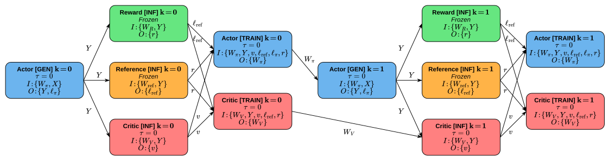
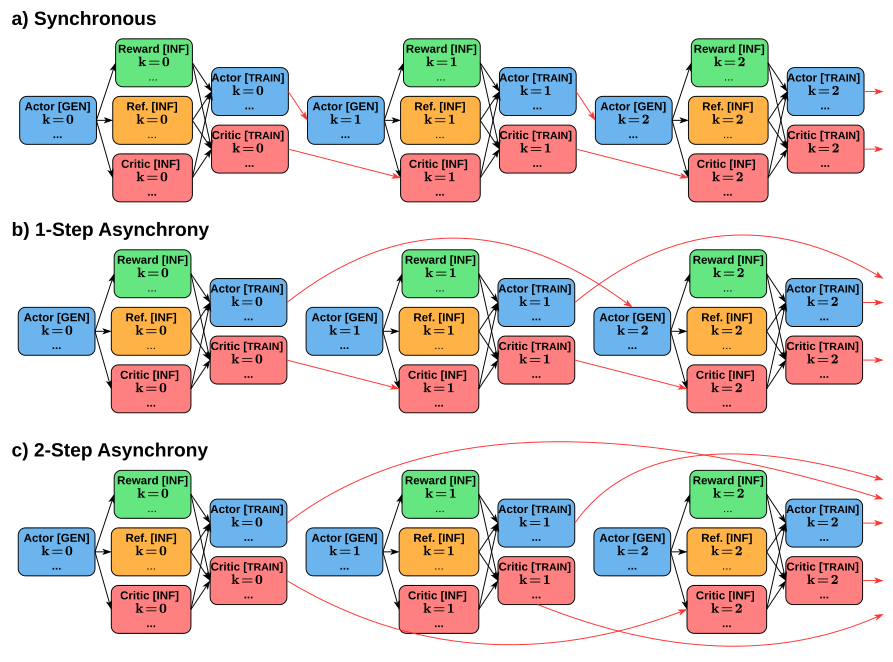
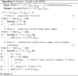
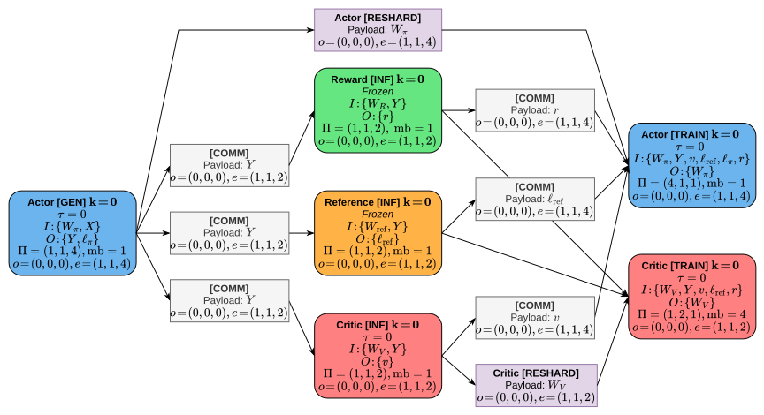
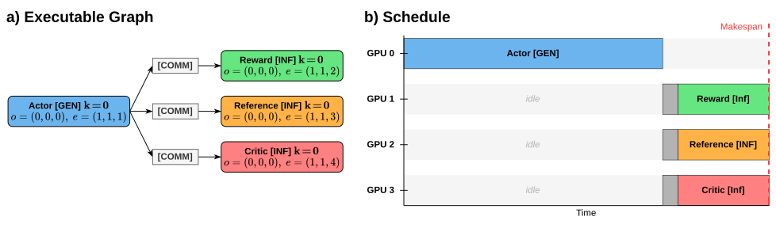
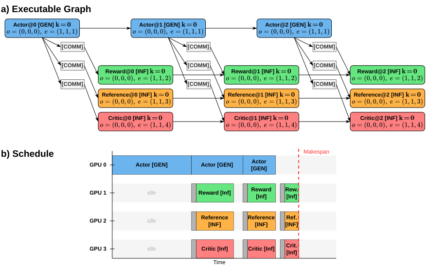
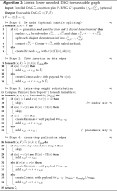

# Passes

Scheduling and subsequent performance evaluation require a finite DAG in which all dependencies are explicit and all data movement (communication and resharding) is materialized as dedicated nodes.
The two deterministic transformations that compile a configuration $C = (G^\circ, P)$ into such a DAG are:
- **Unrolling** expands the cyclic RPEG into a finite acyclic graph $\bar{G}$ over $K_{\mathrm{eval}}$ steps, resolving cross-step publication edges according to the staleness budget $\tau$.
- **Lowering** incorporates the execution plan $P$ to produce the executable graph $\hat{G}$, inserting explicit communication and resharding nodes wherever placement or strategy differences require data movement.
The resulting executable graph $\hat{G}$ serves as input to the cost model and scheduler defined in subsequent chapters. Both transformations are defined generically over any RPEG.


## Unrolling

Before the cyclic RPEG can be [unrolled](unroll.py#L85) into a finite DAG ([UnrolledRPEG](unroll.py#L49)), its ambiguity must be resolved: the staleness budget $\tau(m)$ bounds how old the consumed weights may be, but does not specify which training step provides them.
This publisher selection is formalized first, then the resulting unrolled graph is defined.


### Publication and Bounded Staleness

When $\tau(m) > 0$ for some model $m \in M_\mathrm{train}$, generation at step $k{+}1$ may overlap with training at step $k$, using slightly stale policy weights for rollout generation.
This can be algorithmically acceptable: for example PPO's importance-ratio clipping tolerates bounded policy drift, and recent asynchronous systems such as [AReaL](https://github.com/areal-project/AReaL) exploit this tolerance to pipeline training and generation across steps.

$\tau(m)$ does not determine which specific step provides the weights. To resolve this during unrolling, a publisher-selection function $s_m(k)$ is introduced that maps each step $k$ to the concrete training step whose output it consumes.

Fix $K_{\mathrm{eval}} > 0$. For each trainable model $m\in M_{\mathrm{train}}$, define
```math
s_m(k) = \max\{0,\ k-(\tau(m)+1)\},
\qquad
k\in\{1,\dots,K_{\mathrm{eval}}-1\}.
```
This choice selects the maximally stale admissible publisher and is deterministic. It satisfies
```math
0 \le s_m(k) < k,
\qquad
(k-1)-s_m(k) \le \tau(m).
```
The synchronous case is recovered by enforcing $\tau(m)=0$ for all trainable models, yielding $s_m(k)=k-1$.


### Unrolled Graph

Given a well-formed RPEG $G^\circ$ and an evaluation horizon $K_{\mathrm{eval}} > 0$, the unrolled graph is
```math
\bar{G} = (\bar{V},\ \bar{E}_{\mathrm{data}},\ \bar{E}_{\mathrm{pub}}),
```
with the following components:
- **Vertices.** $\bar{V} = V^\circ \times [K_{\mathrm{eval}}],(v,k)\in\bar{V}.$ Each RPEG vertex is replicated once per step index.
- **Within-step edges.** For each data edge $(u\to v, a)\in E^\circ_{\mathrm{data}}$ and each $k\in[K_{\mathrm{eval}}]$, $(u,k)\xrightarrow{a}(v,k)\in\bar{E}\_{\mathrm{data}}$, carrying the same container $a$ as the RPEG edge, where $[K_\mathrm{eval}] = \{0, \ldots, K_\mathrm{eval}{-}1\}$.
- **Publication edges.** For each publication edge $(u\to v, a)\in E^\circ_{\mathrm{pub}}$ and each $k\in\{1,\dots,K_{\mathrm{eval}}-1\}$ with $k > \tau(\mu(u))$, where $\mu(u)$ denotes the model invoked by vertex $u$, $(u,\;s_{\mu(u)}(k))\xrightarrow{a}(v,k)\in\bar{E}\_{\mathrm{pub}}$, carrying the same weight container $a$ as the RPEG edge. For early steps $k \le \tau(\mu(u))$, no publication edge is created: these steps use the initial parameter version and have no training predecessor. Because no dependency connects them to prior training, these early iterations are free to execute concurrently with one another – each processes a different data batch using the same initial weights.

The following figure shows the synchronous PPO case.
The [cyclic RPEG](../ir/README.md) is unrolled over $K_\mathrm{eval} = 2$ synchronous steps ($\tau = 0$).
Each RPEG vertex is replicated per step, data edges are copied within each step, and publication edges are wired across step boundaries according to the staleness budget $\tau$.

<p align="center">
  
</p>

The next figure illustrates how varying $\tau$ changes the structure of the unrolled graph (simplified; operator attributes and edge containers omitted for clarity).
(a) Synchronous execution ($\tau = 0$): publication edges connect consecutive steps, enforcing strict ordering.
(b) One-step bounded staleness ($\tau(\pi_\theta) = 1$): actor publication edges span two steps, enabling concurrent generation and training.
(c) Two-step bounded staleness ($\tau(\pi_\theta) = 2$, $\tau(V_\psi) = 1$): deeper overlap with longer publication arcs.
Red arrows denote publication edges carrying weight containers $W_\pi$ and $W_V$; black arrows denote within-step data edges.
<p align="center">
  
</p>
The key structural property of the unrolled graph is acyclicity.


### Algorithm

The following algorithm gives a high-level overview of the complete unrolling procedure. The runtime is
```math
O(K_\mathrm{eval} \cdot (|V^\circ| + |E^\circ_\mathrm{data}| + |E^\circ_\mathrm{pub}|)),
```
as each of the three steps in the pseudocode iterates over one component of the RPEG, replicated $K_\mathrm{eval}$ times.
<p align="center">
  
</p>
Each unrolled edge inherits the container from its RPEG edge. The algorithm omits this for brevity.


## Lowering

Lowering is the stage at which the unrolled graph $\bar{G}$ and the execution plan $P$ are combined into a single hardware-aware DAG.
Concretely, lowering takes the pair $(\bar{G}, P)$ and constructs the executable graph $\hat{G}$ by traversing the nodes and edges of $\bar{G}$ and inserting *Comm* and *Reshard* nodes wherever the execution plan requires data movement or weight redistribution.
Formally, the executable graph is a DAG
```math
\hat{G} = (\hat{V}, \ \hat{E}),
```
whose nodes are of three kinds:
- *Op* nodes correspond to unrolled RPEG vertices, each attributed with a device allocation, parallel strategy, and microbatch count from the execution plan.
- *Comm* nodes represent data transfer between *Op* nodes placed on different device allocations (on both data and publication edges).
- *Reshard* nodes represent weight redistribution when successive invocations of the same model use different parallel layouts on the same devices.

The following figure shows a PPO-based executable graph for one step, which was derived from the [RPEG](../ir/README.md) via unrolling and lowering.
*Comm* and *Reshard* nodes are inserted wherever the execution plan requires data movement between different device allocations or parallel layouts.

<p align="center">
  
</p>

Before describing the lowering procedure itself, we specify the attributes that distinguish the three node kinds.
Each *Op* node occupies exactly one [device allocation](../core/types.py#L245) (as specified by the execution plan).
*Comm* and *Reshard* nodes are attributed with source and destination allocations.
The [transfer policy](#transfer-resources) determines their reservations: runtime planning defaults to both endpoints, how also supports, that only the destination is reserved for source-overlap paths.
Activation transfers, that change the DP degree, always reserve both endpoints.

Every node in $\hat{G}$ carries a **payload** in Bytes:
- each *Comm* node starts from the container volume on its data or publication edge, where phase splitting and overlapping weight allocations can reduce this payload,
- each *Reshard* node carries a payload equal to the full parameter size of the associated model,
- *Op* nodes carry zero payload.


### Stage 1: Operator Instantiation

For every unrolled vertex $(v,k)\in\bar{V}$, an *Op* node $x_{v,k} \in \hat{V}$ with device allocation $\sigma(v)$, parallel strategy $\Pi(v)$, and microbatch count $\mathrm{mb}(v)$ is created.
When generation quantile splitting is enabled (see below), generation and inference vertices may be replaced by multiple sub-nodes during this stage.


#### Response-Length–Aware Sub-Node Splitting

Autoregressive generation produces responses of highly variable length.
In reasoning workloads, response-length distributions are heavily skewed: many sequences finish quickly while a small number of long-tail rollouts dominate wall-clock time.
In a monolithic generation operator, the entire batch must finish before any downstream inference can begin – the longest response delays all subsequent work.
When generation and inference are placed on disjoint devices, the lowering pass can exploit this skewness by splitting generation into phases based on the response-length distribution, allowing inference to start processing early-finishing sequences while longer ones continue decoding.
This is related to the inter-stage fusion mechanism proposed by [RLHFuse](https://github.com/FlexFusion/FlexFusion), but expressed here as a structural graph transformation within the lowering pass rather than a runtime scheduling decision.

The response-length distribution is specified by $Q$ quantile breakpoints
```math
(f_1, t_1),\; (f_2, t_2),\; \ldots,\; (f_Q, t_Q),
```
where each $f_q \in (0, 1]$ is a cumulative fraction of sequences and $t_q$ is the number of generated tokens at which that fraction completes. We require $f_Q = 1$ (all sequences finish by $t_Q = T$) and $f_1 < f_2 < \cdots < f_Q$.

An example of response-length quantiles with $Q = 4$ and breakpoints would be
```math
\bigl((0.25, 512),\; (0.50, 1024),\; (0.85, 1536),\; (1.0, 2048)\bigr),
```
where 25\% of the sequences finish within 512 tokens, 50\% within 1024, 85\% within 1536, and all by 2048.


#### Obtaining the Response-Length Distribution

The quantile breakpoints $(f_q, t_q)$ are obtained empirically by profiling generation lengths on a representative sample of prompts.
Before optimization, a small subset of the training prompts (e.g., a few hundred) is processed through the current model checkpoint, and the empirical response-length distribution is recorded.
The quantile breakpoints are then fitted directly from this sample.
The number of quantiles $Q$ controls the granularity of the sub-node splitting: $Q = 1$ recovers the monolithic generation operator, while larger $Q$ enables finer-grained overlap at the cost of additional nodes in the executable graph.
In practice, $Q \in \{3, 4, 5\}$ captures the relevant structure of the distribution without introducing excessive graph complexity.


#### Splitting Mechanism

The lowering pass splits a generation vertex into sub-nodes only when the execution plan places generation and at least one downstream inference operator on disjoint devices – otherwise no overlap is possible and the operator remains an indivisible *Op* node.
Concretely, for each generation vertex $(v, k)$ with a disjoint downstream inference vertex:
- The single *Op* node $x_{v,k}$ is replaced by $Q$ generation sub-nodes $x_{v,k}^{g_1}, \ldots, x_{v,k}^{g_Q}$, chained sequentially on the same devices. Sub-node $x_{v,k}^{g_q}$ represents the decode phase during which the fraction $f_q - f_{q-1}$ of sequences complete (with $f_0 = 0$). The first sub-node additionally includes the prefill phase.
- Each downstream inference vertex $w$ on disjoint devices is similarly split into $Q$ inference sub-nodes $x_{w,k}^{i_1}, \ldots, x_{w,k}^{i_Q}$, also chained sequentially on their own devices.
- Generation sub-node $q$ is connected to inference sub-node $q$ via a *Comm* node with payload $\\#a \cdot s(a) \cdot (f_q - f_{q-1})$ Bytes – the container volume scaled by the fraction of sequences completing in that phase.

All sub-nodes inherit the device allocation, parallel strategy, and microbatch count from the original RPEG vertex.

The following two figures illustrate the effect of sub-node splitting on both the executable graph and the resulting schedule for a 4-GPU example.
For clarity, only device allocations (origin $o$, extent $\delta$) are shown on each node; parallel strategies, microbatch counts, and read/write interfaces are omitted.
The first figure shows the execution without sub-node splitting.
(a) Executable graph: generation on GPU 0 feeds three inference operators on GPUs 1–3 via *Comm* nodes.
(b) Schedule: inference GPUs are idle for the entire duration of generation, since no partial results are available until the full batch completes.
<p align="center">
  
</p>

The second figure shows the execution with quantile-based sub-node splitting ($Q = 3$) enabled.
(a) Executable graph: generation and each inference operator are split into three sub-nodes chained sequentially.
Each generation sub-node feeds the corresponding inference sub-nodes via *Comm* nodes.
(b) Schedule: inference sub-nodes from early-finishing sequences overlap with later generation phases, substantially reducing idle time and makespan.
<p align="center">
  
</p>

Crucially, this wiring makes generation-inference overlap (inter-stage fusion) possible but does not enforce it.
The optimizer controls whether overlap occurs by choosing the device allocations: if it places generation and inference on disjoint devices, the scheduler can execute inference sub-nodes concurrently with later generation sub-nodes.
If the optimizer places them on the same devices, the scheduler serializes them and no overlap occurs – in this case, no splitting is performed, since sub-nodes on shared devices would add graph complexity without enabling any concurrency.


### Stage 2: Communication Node Insertion

When sub-node splitting has been applied, the edges between generation and inference sub-nodes created in Stage 1 are processed by the following stages in the same way as edges between unsplit *Op* nodes – *Comm* and *Reshard* insertion does not distinguish between them.
We traverse the data edges of $\bar{G}$.
For each edge $(u,k)\xrightarrow{a}(v,k)\in\bar{E}\_{\mathrm{data}}$ with container $a$:
- **Same allocation**, i.e., $\sigma(u) = \sigma(v)$: no transfer is needed. We add a precedence edge $x_{u,k} \to x_{v,k}$.
- **Different allocation**, i.e., $\sigma(u) \neq \sigma(v)$: data must move between device allocations. We insert a *Comm* node $c$ with payload $\\#a \cdot s(a)$ Bytes and add edges $x_{u,k} \to c \to x_{v,k}$.

After this stage, all cross-allocation data movement is represented explicitly.


### Stage 3: Intra-Iteration Weight Redistribution

When two operators of the same trainable model appear within one iteration, the lowering pass must ensure that the second operator receives weights in a compatible layout.
To identify such pairs, we [compute a topological ordering](lower.py#L135) $\mathrm{Topo}(G^\circ)$ of $(V^\circ, E^\circ_{\mathrm{data}})$, collect all vertices with $\mu(v) = m$ for each trainable model $m$ (frozen models have fixed weights and are never resharded), and define $\mathrm{Pairs}(m)$ as the consecutive pairs in this ordering.

Not every pair requires resharding.
Depending on the staleness budget and device placement, a pair falls into one of two categories (shadow pairs and non-shadow pairs) which the lowering pass handles differently.


#### Shadow Pairs

In synchronous RLM training, generation and training of the same model execute sequentially and may share a single weight copy that is resharded between them as needed.
When $\tau(m) > 0$ and the optimizer places the two operators on disjoint device allocations, a more efficient pattern becomes possible: each device allocation maintains its own persistent weight copy, eliminating per-step resharding and enabling concurrent execution.
We call this a shadow pair, which is formally a consecutive pair $(u, v) \in \mathrm{Pairs}(m)$ of a trainable model $m \in M_\mathrm{train}$ under execution plan $P$ if:
1. $\tau(m) > 0$ (bounded asynchrony), and
2. $\sigma(u) \cap \sigma(v) = \emptyset$ (device disjointness).

Both conditions are necessary.
Without asynchrony ($\tau = 0$), training at step $k$ must finish before generation at step $k{+}1$ can begin.
Separate serving workers still retain their own weight copies when allocations differ regardless whether a synchonous or an asynchronous schedule is used.
Colocation can reduce copying, but its performance depends on layout changes and contention with other operators.

Without device disjointness, the shared devices would need to hold two weight versions simultaneously, and the scheduler would have to serialize the operators on the overlapping devices, eliminating the concurrency benefit.

When a shadow pair is active, two weight instances coexist in the device space:
- **Training instance** on $\sigma(t_m)$: holds up-to-date weights, optimizer state (FP32 master weights, first and second moments), and gradients. This is the source of parameter updates.
- **Shadow instance** on the consumer's devices (e.g., $\sigma(g_m)$ for generation or $\sigma(i_m)$ for inference): holds a read-only BF16 weight snapshot. This copy is periodically refreshed by a *Comm* node that transfers updated weights from the training instance (Stage 4).

Because no intra-step reshard or precedence edge connects the two sides, they are free to execute concurrently.
The idea of maintaining stale parameter replicas for concurrent execution appears in recent asynchronous RLM training systems such as [AReaL](https://github.com/areal-project/AReaL); our framework exposes it as a structural property of the execution plan that the optimizer can discover automatically.
For shadow pairs, the lowering pass skips the intra-step reshard entirely: no *Reshard* node and no precedence edge are inserted between $x_{u,k}$ and $x_{v,k}$ within any step $k$.


#### Non-Shadow Pairs

For each non-shadow pair $(u, v) \in \mathrm{Pairs}(m)$ and each $k \in [K_\mathrm{eval}]$:
- **Same allocation and strategy**, i.e., $\sigma(u) = \sigma(v)$, $\Pi(u) = \Pi(v)$: the weight layout is already compatible; no action.
- **Same allocation, different strategy**, i.e., $\sigma(u) = \sigma(v)$, $\Pi(u) \neq \Pi(v)$: the weights reside on the same devices but in an incompatible parallel layout. We create a *Reshard* node $r \in \hat{V}$ with payload $\\#W_m \cdot s_b$ Bytes (the full parameter count of model $m$) and add edges $x_{u,k} \to r \to x_{v,k}$ to $\hat{E}$.
- **Different allocation**, i.e., $\sigma(u) \neq \sigma(v)$: the two operators run on different (possibly overlapping) device allocations – for example, inference on 8 GPUs and training on 16 GPUs with partial overlap. Since this is not a shadow pair, $\tau(m) = 0$ or the allocations are not fully disjoint. Distinct serving workers retain their active weight version from publication through consumption, including synchronous execution. The [memory model](../model/README.md#co-residency-aware-device-peaks) counts that persistent receiving copy separately from the training worker. No intra-step weight redistribution is needed. If a data path already orders the pair, no extra edge is inserted; otherwise a bare precedence edge $x_{u,k} \to x_{v,k}$ orders the operators.


### Stage 4: Cross-Iteration Publication Edges

Stages 1 to 3 handle within-step structure.
The final stage wires the cross-step publication edges that carry updated weights from training at an earlier step to consumers at a later step.
For each publication edge $(u,k') \xrightarrow{a} (v,k) \in \bar{E}\_{\mathrm{pub}}$ with $k' < k$, the lowering pass selects one of three actions based on the relative placement and strategy of source and destination:
- **Same allocation and strategy**, i.e., $\sigma(u) = \sigma(v)$, $\Pi(u) = \Pi(v)$: a bare precedence edge $x_{u,k'} \to x_{v,k}$ suffices.
- **Same allocation, different strategy**, i.e., $\sigma(u) = \sigma(v)$, $\Pi(u) \neq \Pi(v)$: we insert a *Reshard* node as in Stage 3.
- **Different allocation**, i.e., $\sigma(u) \neq \sigma(v)$: the updated weights must be sent from the training devices to the consumer's devices. We insert a *Comm* node $c$ with edges $x_{u,k'} \to c \to x_{v,k}$; the source retains its copy. When the source and destination allocations partially overlap, devices in the intersection can produce their weight shard locally, reducing the transfer to $\\#W_m \cdot s_b \cdot (n_\mathrm{max} - n_\mathrm{overlap}) / n_\mathrm{max}$, where $n_\mathrm{max} = \max(|\sigma(u)|, |\sigma(v)|)$ and $n_\mathrm{overlap} = |\sigma(u) \cap \sigma(v)|$.

An [illustration](../model/README.md#co-residency-aware-device-peaks) in the [modeling README](../model/README.md) visualizes five representative placement and parallelization scenarios, covering both shadow and non-shadow pairs, and shows how *Comm* and *Reshard* nodes are inserted in each case, together with the resulting memory layout.


### Algorithm

The following algorithm gives the complete lowering procedure. The runtime is
```math
O\left(K_\mathrm{eval} \cdot (|V^\circ| + |E^\circ_\mathrm{data}| + |E^\circ_\mathrm{pub}|) \right),
```
since the number of intra-step model pairs is bounded by $|V^\circ|$.

<p align="center">
  
</p>


### Intra-Stage Actor-Critic Fusion

In addition to generation-inference phase splitting, the lowering pass can combine actor and critic training into an intra-stage composite operator.
Both members must use the same allocation, parallel strategy, and microbatch count, with pipeline parallelism greater than one and enough microbatches to fill it.
The models retain separate parameters and optimizer state.

`CompositeExecOperator` records the semantic composite while preserving member node IDs for dependencies and trace attribution.
The [fused pipeline scheduler](../runtime/fused_pipeline.py) constructs a dependency-complete bidirectional microtask schedule.

Lowering also inserts lifetime barriers for colocated trainable layout changes.
A serving layout is returned to its training layout before another colocated model's serving publication when required by data reachability.
This prevents overlapping retained layouts that the worker-lifetime memory model does not budget.


## Transfer of Resources

The DAG enables reasoning about communication, i.e., what is transferred.
The functionality provided in [transfer_resources.py](transfer_resources.py) allows to determine which devices those transfers reserve.
Weight and activation transfers may have different policies.
With `both_endpoints`, source and destination allocations remain reserved for the transfer interval.
With `destination_only`, transfers reserve the destination.
Activation transfers additionally require equal source and destination DP degrees, which are determined from their adjacent operators.
DP-changing activation transfers reserve both endpoints even under a destination-only policy.
