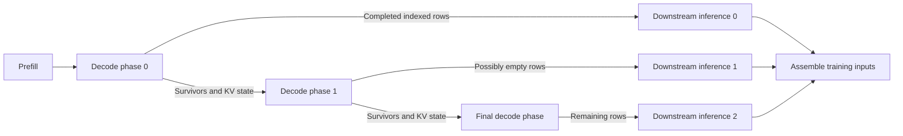

# Dataflow and Data Lifetime

An execution edge carries both a value and an ownership obligation. Its consumer must receive the correct samples or model version, in the layout expected by its worker, before the producer's state can be reclaimed. Placement and scheduling alone do not establish this contract.


## Activation Records

[ContainerRef](containers.py) describes a logical output: producer, step, owner, shape, dtype, sharding, and optional storage location. `ContainerStore` indexes these references and weight-version metadata. The distributed semantic backend implements the associated tensor storage and transfer operations in [semantic_worker.py](semantic_worker.py).

Generated samples carry token data, response masks, and the policy information needed by the algorithm. Reference, reward, and value inference add aligned outputs. Training joins these results by their logical sample identity. The [algorithm guide](algorithms/README.md) follows how the records become loss inputs.

For $B$ prompts and $K$ responses per prompt, the rollout contains $N=BK$ logical samples. Generation phases preserve a global index in this rollout even when their local tensors are compacted. The index is distinct from the position of a row in a transferred shard.

For example, suppose four samples finish in this order:

<div align="center">

| Phase | Completed global indices | Still decoding |
|---|---|---|
| 0 | `[1, 3]` | `[0, 2]` |
| 1 | `[]` | `[0, 2]` |
| 2 | `[0, 2]` | `[]` |

</div>

The first phase's row zero represents sample 1. Treating it as sample 0 would attach the wrong reward, value, or prompt-group membership. Empty phase 1 remains part of the dependency graph even though it transfers no completed samples. Sparse indexed records let downstream layouts reconstruct these relationships.


## Generation Boundaries and KV State

The planner's quantiles $(f_q,t_q)$ describe predicted completion fractions at token boundaries. The estimated number of completions in phase $q$ is

```math
\widehat{n}_q = BK(f_q-f_{q-1}), \qquad f_{-1}=0.
```

The actual set $I_q$ contains the samples emitted by decoding at that phase. It can differ from the estimate: $|I_q|$ need not equal $\widehat{n}_q$. EOS behavior determines completion; quantiles determine where the graph exposes intermediate work.



The diagram shows dependencies, not guaranteed simultaneous execution.
Actual overlap also requires compatible allocations and transfer reservations.
The `static_kv` generation backend retains decoding state.
Cache size and bucket settings live under `runtime.static_kv_cache_*`.
[generation_profile.py](generation_profile.py) measures completion lengths for later planning.


## Weight Versions and Staleness

Runtime steps are one-based, while unrolled IDs such as `g_pi@0` use a zero-based iteration suffix.
Version 0 denotes the initial weights.
Training at logical step $s$ produces the corresponding updated version.
A serving consumer with staleness $\tau_m$ requests

```math
v_m(s)=\max(0,\ s-1-\tau_m).
```

This selection is implemented by [consumer_weight_version()](weight_versions.py). It requests a specific version, rather than whichever update happened to finish most recently.

<div align="center">

| Logical step $s$ | Serving version with $\tau=0$ | Serving version with $\tau=1$ |
|---|---|---|
| 1 | 0 | 0 |
| 2 | 1 | 0 |
| 3 | 2 | 1 |
| 4 | 3 | 2 |

</div>

Publication edges make the required versions available to consumers.
With a non-zero $\tau$, the Megatron runtime requires disjoint publisher and serving allocations, so the older serving state can coexist with training.
A colocated layout switch cannot supply independently live shadow copies.
Local semantic tests may retain historical CPU state dictionaries, which does not relax the distributed allocation rule.

The handler tracks versions required by unfinished consumers before pruning old storage. `runtime.semantic_weight_keep_latest` also controls retention, but the lifetime calculation must preserve versions still needed by the graph. A serving worker's active version, a portable publication, and the train worker's optimizer state have different lifetimes and memory costs.


## Transfer Reservations

Activation communication moves records; weight communication installs a selected model version.
A `RESHARD` operation changes the parameter or optimizer layout.
A transport's reservation policy is part of the compiled plan because it determines which operations can overlap.

The policy in [transfer_policy.py](transfer_policy.py) is:

<div align="center">

| Transfer | Default reservation | With `direct_source_overlap: true` |
|---|---|---|
| Weights | Both endpoints | Destination only for `ucx_direct` |
| Activations | Both endpoints | Destination only for `ucx_direct` or `tcp_direct`, when adjacent DP degrees agree |
| Activation redistribution across DP degrees | Both endpoints | Both endpoints |

</div>

[transfer_resources.py](../passes/transfer_resources.py) applies these rules to each lowered edge. [graph.py](graph.py) adds worker command-channel reservations as well as GPU reservations. Destination-only reservation is a scheduling capability of selected transport paths, where the source still participates in moving the data.

Transport and storage are separate choices. `runtime.activation_transport` selects movement, while `runtime.activation_store` selects `filesystem`, `memory`, `hybrid`, or `auto`. In the Megatron handler, `auto` resolves to memory for UCX without replay, hybrid for UCX with replay, and filesystem for other transports. Replay with an explicitly memory-only store is rejected because volatile records cannot supply durable recovery.


## Reclamation and Memory Accounting

Activation cleanup runs after all training consumers for the step complete. Weight cleanup considers unfinished version consumers. Operational low-precision weights can be released and rematerialized while FP32 master parameters and Adam state remain resident. Serving caches also occupy memory between operations.

Consequently, summing only the tensors used by the currently running operator underestimates the device peak. The [memory model](../model/README.md#co-residency-aware-device-peaks) includes persistent worker state, serving copies, semantic caches, and transient or fused activation peaks. A CUDA semantic cache requires a positive `hardware.semantic_activation_cache_bytes` reservation and a compatible memory or hybrid store.

Checkpoint recovery must preserve these version obligations across worker restarts. The [recovery guide](recovery.md) explains why restoring train weights alone is insufficient.
