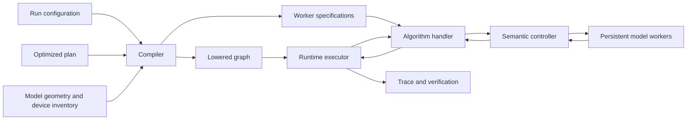

# Runtime Graph Compilation and Execution

The analytical scheduler assigns predicted intervals to a lowered graph. The runtime executes that graph using measured completion events. Both use the same operator placements and transfer reservations, but a predicted duration never determines when a real tensor operation has finished.

This guide follows a job from its serialized plan to the worker that performs an operation. The [runtime overview](README.md) introduces the artifacts and command-line entry points.


## Compilation Pipeline



[compile_runtime_plan()](compiler.py) reconstructs the graph from the plan's algorithm, structural choices, and assignments. It unrolls `training.max_steps` iterations and lowers publication, activation movement, layout changes, generation phases, and any fused training operators. Compilation also resolves logical device coordinates against the cluster inventory.

Several checks establish that the serialized plan has the same meaning at execution time:

<div align="center">

| Concept | Validation |
|---|---|
| Artifact identity | Plan file matches `optimized_plan.expected_hash`, when supplied. |
| Workload | Algorithm, batch dimensions, sequence lengths, generation quantiles, and device space agree. |
| Placement | Allocation size equals `DP × PP × TP`, and each layout fits the device topology. |
| Model geometry | Layer count is divisible by PP; TP fits the GPUs per node. |
| Batch geometry | Rollout and training minibatches divide across DP and pipeline microbatches. |
| Runtime policy | Required fusion and transfer reservations agree with the plan. |
| Capacity | Available hardware memory information supports the compiled memory and worker-density checks. |

</div>

For rollout size $N=BK$, data-parallel degree $d$, training minibatch size $b$, and pipeline microbatch count $m$, the compiler requires

```math
N \bmod d = 0, \qquad N \bmod b = 0, \qquad b \bmod d = 0.
```

With PP greater than one, the local execution batch must also divide by $m$: training uses $b/d$, while generation and inference use $N/d$. With PP equal to one, the plan must use $m=1$. Here `microbatch` is a **count**, not the number of samples in each microbatch. These constraints are implemented in `_validate_exactness()` in [compiler.py](compiler.py).


## Workers

A graph vertex is an operation template, while a worker is a persistent owner of model state. Several vertices may therefore belong to one worker group.

The compiler groups vertices by `(model, allocation.origin, allocation.extent)`. A colocated generation and training pair for the same model can share a worker group even when its operations request different parallel layouts. The worker specification retains each vertex's DP/PP/TP, microbatch count, and role so layout changes can be explicit. Separate model identities retain separate workers even when they occupy the same GPUs.

This distinction explains two resource keys in [graph.py](graph.py):

- `gpu:r:n:g` identifies one logical GPU and prevents incompatible operations from occupying it together.
- `worker:worker_id` protects a persistent worker's state and command channel.

Transfers acquire the corresponding endpoint resources under the selected [transport policy](dataflow.md#transfer-reservations).


## Dependency-Driven Dispatch

Let $C$ be the completed nodes, $O$ the occupied resource keys, $\mathrm{pred}(v)$ the predecessors of node $v$, and $R(v)$ its resource keys. A pending node is eligible when

```math
\mathrm{pred}(v) \subseteq C
\quad\land\quad
R(v) \cap O = \varnothing.
```

The [RuntimeExecutor](executor.py) repeatedly performs the following steps:

1. Collect pending nodes whose predecessors have completed.
2. Order them by logical step, then transfer priority (`COMM` and `RESHARD` before `OP`), then position in the graph's preferred order.
3. Launch eligible nodes while resources and the optional task-concurrency limit permit.
4. Wait for a task to finish, record its result, release its resources, and invoke the handler's completion hook.

Prioritizing older transfers prevents later inference from repeatedly taking a worker needed to send an earlier step's results.
Dependencies still determine correctness, while the priority controls which ready operation wins a resource conflict.

An algorithm handler can select several ready nodes for one task through `select_batch()` and `execute_batch()`. Fused actor/critic training uses coordinated execution with the union of the member resources. Each member still receives a result and trace events. The optional concurrency limit counts running tasks, so a fused batch occupies one task slot.

If a handler raises an exception, the executor records the failing task, cancels the remaining tasks, and raises `RuntimeExecutionError`. If no task can run and dependencies remain unresolved, it reports the waiting nodes. Recovery is managed by the [algorithm execution wrapper](recovery.md), outside this dispatch loop.


## Interface

The executor calls `RuntimeOperationHandler.execute(node, context)` and receives a `NodeExecutionResult` containing the node ID, counters, and any container or weight references. The context carries completed results, the metadata store, and handler state.

<div align="center">

| Layer | Owns | Implementation |
|---|---|---|
| Executor | Readiness, reservations, completion, task errors | [executor.py](executor.py) |
| Algorithm handler | Meaning of graph operations, training inputs, publication, completion hooks | [algorithms/](algorithms/README.md) |
| Semantic controller | Worker startup, requests, responses, shutdown | [semantic_controller.py](semantic_controller.py) |
| Semantic worker | Artifact lookup, operation requests, transfer endpoints | [semantic_worker.py](semantic_worker.py) |
| Model worker | Forward/backward computation, generation, optimizer state | [workers/](workers/README.md) |

</div>

The metadata handler exercises the first two layers using references and counters. Local Torch handlers add tensor computation for supported algorithm paths. The Megatron handler coordinates distributed worker groups through semantic requests.
