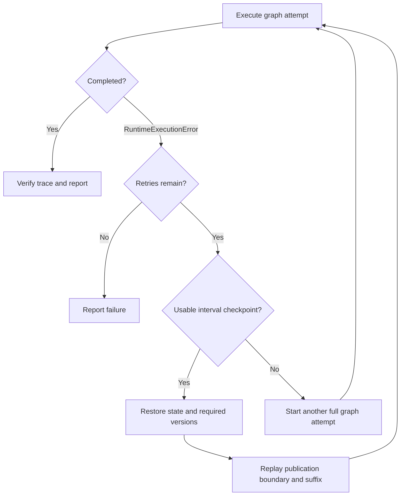

# Recovery

A completed graph node is an execution artifact, while a durable checkpoint is a recovery boundary. The distinction matters when several iterations overlap: training may have advanced while a serving worker still needs an older model version.


## Checkpoints

In the distributed graph handler, the completion hook waits until all training nodes for a logical step have finished before considering that step's interval checkpoint and releasing its training activations. Checkpoint publication barriers preserve the relevant ordering around this boundary.

The main settings are:

<div align="center">

| Setting | Purpose |
|---|---|
| `checkpoints.output_dir` | Root for checkpoint artifacts and their index |
| `checkpoints.interval_steps` | Interval checkpoint cadence |
| `checkpoints.keep_last_interval_steps` | Number of interval checkpoints retained; unset keeps all |
| `checkpoints.save_final` | Whether to save final state |
| `checkpoints.resume_from` | State source for worker initialization |
| `checkpoints.portable_weight_versions` | Request portable train-version storage, including optimizer state |

</div>

The index uses schema `rpeg.checkpoint_index.v1` and distinguishes interval and final checkpoints. Weight-version manifests describe the publications needed after restoration. Their metadata includes integrity and layout information. Recovery checks file counts, bytes, and available rank state rather than assuming that a directory name establishes completeness.

With staleness, restoring only the most recent train weights can lose a version required by the next consumer. A usable recovery checkpoint must retain those historical publications as well. The manifest and selection logic are implemented in [megatron_ppo_graph.py](algorithms/megatron_ppo_graph.py).
When interval replay requires historical versions, set `checkpoints.portable_weight_versions: true`; the handler rejects native-only checkpoint recovery for that case.


## Bounded Graph Replay

The Megatron graph wrapper reads `monitoring.graph_replay_retries`, whose default is zero. It catches `RuntimeExecutionError` and makes at most that many additional attempts. Configuration and dependency errors are not covered by this retry loop.



For a recovered step $s$, `_suffix_runtime_graph()` retains nodes from later steps and weight `COMM`/`RESHARD` nodes at the checkpoint boundary. It removes dependencies on the restored prefix. Boundary publications run again because restarted serving workers have lost their volatile replicas, even if a transfer had succeeded before the failure.

An absent usable interval checkpoint permits another full attempt within the retry budget. A malformed index or an invalid required manifest is an error. A memory-only activation store is incompatible with replay, so a durable filesystem or a hybrid configuration should be used. The [data-flow guide](dataflow.md#transfer-reservations) explains how `auto` resolves storage.

This replay path operates on the already compiled graph and placement. It does not search for a new allocation after a failure. Manual `resume_from` provides an initialization source. The retry wrapper additionally selects and verifies a graph suffix from its checkpoint index.


## Traces

[RuntimeTraceWriter](trace.py) writes JSONL events keyed by `run_id` and lowered `node_id`. Each event carries a timestamp, status, optional worker and logical step, and operation-specific counters.

<div align="center">

| Event | Meaning |
|---|---|
| `start` | The executor reserved the node's resources and dispatched it. |
| `finish` | A result or execution error was recorded; counters include elapsed duration. |
| `replay` | Another graph attempt began after an execution failure. |
| `recover` | An interval checkpoint restored a prefix and its version state. |

</div>

Lifecycle nodes such as `runtime.workers.start` describe initialization and teardown around graph work. They are distinguished from lowered operator IDs. Fused batches retain member events and identify the nodes dispatched together, so shared reservations can be checked as coordinated work.

[verify_runtime_trace()](verification.py) checks the final attempt against the compiled graph. It checks node coverage, successful status, paired events, dependency timing, conflicting resource intervals, logical steps, selected weight versions, and applicable generation/transfer counters. For recovery, it also checks the skipped prefix and restoration counters. Earlier failed attempts remain in the trace, but their incomplete node coverage does not count as successful final execution.

Use [plot_trace.py](plot_trace.py) to inspect the measured timeline. Use [metrics.py](metrics.py) for summaries, alerts, and exported monitoring data. A graph trace identifies operation boundaries, but numerical tests are still needed to establish that the tensors and optimizer updates are correct.


## Validation Levels

<div align="center">

| Level | Validation | Entry point |
|---|---|---|
| Compilation | Artifact, geometry, placement, and available capacity checks | `runtime.run --dry-run` for a tensor backend |
| Metadata graph | Dependencies, resource ownership, version counters, trace coverage | `runtime.run --execute-graph-metadata` |
| Full graph validator | Input, unrolling, lowering, workers, and metadata execution checks | `runtime.validate_full --config ...` |
| Numerical execution | Real losses, updates, and tensor semantics for the selected backend | Numerical tests and `runtime.validate_full --execute-real-backend` |
| Distributed execution | Actual worker launch, collectives, transport, and device behavior | |

</div>

For a full validation, run:

```bash
python -m runtime.validate_full \
    --config /tmp/rpeg-runtime-docs/generated/grpo_metadata_run.yaml \
    --trace-path /tmp/rpeg-runtime-docs/traces/grpo.validation.jsonl
```

The default full validator executes metadata operations. `--execute-real-backend` adds the configured numerical backend and requires its dependencies and model files.


## Trace-Backed Planning

[cost_calibration.py](cost_calibration.py) compares successful measured operation durations with estimates from an optimized plan.
It records coverage and provenance, and can exclude warmup steps.
The suggested, calibrated parameters can be used during subsequent planning steps.
